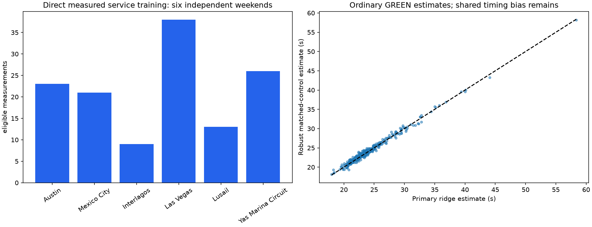
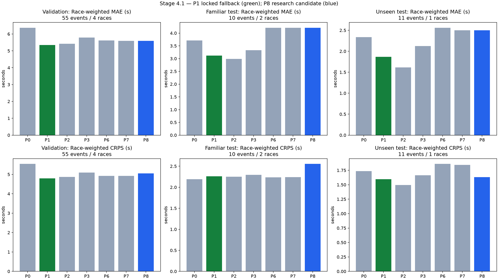

# Stage 4.1 — Validation and stabilization

Stage 4 stabilization is implemented and evaluated. The locked selection is **P1**, with role **SIMPLE_NET_LOSS_FALLBACK_NO_APPROVED_SERVICE_RISK**. This is a research result, not unrestricted strategy approval. Circuit-reference feature validation and physically validated VSC/SC loss labels remain unmet requirements. Stage 5 work has not started.

## Scope and preservation

The reviewed Stage 4 run, model pickles, figures and report are unchanged. Stage 3 source/report hashes and the pit time-accounting contract are unchanged. The absent original Stage 3 fitted model artifacts still prevent a claim of bit-for-bit fitted-artifact reproduction. The accounting remains `normal racing reference + net transition loss`; lane duration already contains stationary service. Calibration retains the shared reference-error draw with its original sign, and a known +2.5 s service scenario changes total loss by exactly +2.5 s.

## 1. Exceptional visits and one eligibility policy

Policy `stage4.1-ordinary-v1` applies to every candidate. Any positive RED overlap, invalid timing, unresolved double stack or lane stay above 60 s excludes ordinary direct evaluation. Duration triggers review without assigning a repair or penalty cause. Recorded BLUE flags and repeated pit operations within the two-lap window exclude the net-loss label while retaining eligible measured lane/service observations. Forecasts at a non-GREEN cutoff are not scored against an eventual GREEN counterfactual.

All raw visits remain available. Compatible flags include confirmed/unverified routine status, red overlap, unresolved long hold, repair/garage evidence, penalty evidence and ambiguous timing. Reclassifying the reviewed run retains 979 events; 21 have RED overlap, and **0 remain ordinary-lane eligible**. Direct-lane eligibility changes from 944 to 912 across that run. The Monza `11361:63:1` 1,846.2 s and Catalunya `11307:23:3` 777.7 s observations are retained and excluded; their causes are not inferred from duration.

The fixed old predictions are rescored, without refitting to their errors:

| Model | Old eligible n | Old lane MAE s | Policy eligible n | Policy lane MAE s |
| --- | --- | --- | --- | --- |
| P9 | 150 | 260.636 | 128 | 1.272 |
| P10 | 150 | 260.618 | 128 | 1.257 |

These before/after MAEs describe different eligibility populations. They demonstrate removal of misclassified holds, not a model accuracy improvement on identical events. Independently confirmed routine visits: **0**. The confirmed-only sensitivity is therefore `NO_EVALUABLE_EVENTS`; all reported ordinary results use explicitly screened-unverified visits.

## 2. Independent service evidence

Measured training service evidence expands from 23 stops at one weekend to **130 stops at 6 weekends, 6 circuits and 10 teams**. Missing service times are not converted into measured zeros. All training weekends precede the early-2025 validation races. Team estimates remain pooled; six weekends do not establish broad team/season calibration.

| Session | Circuit | Measured eligible stops |
| --- | --- | --- |
| 9617 | Austin | 23 |
| 9625 | Mexico City | 21 |
| 9636 | Interlagos | 9 |
| 9644 | Las Vegas | 38 |
| 9655 | Lusail | 13 |
| 9662 | Yas Marina Circuit | 26 |

Provenance is saved in `service_training_provenance.csv`; raw endpoint snapshots and their SHA-256 hashes are recorded in each phase's data manifest.

## 3. Circuit references and Lusail

FIA access is now active. A post-lock audit covers **34 race weekends**, with **14 explicit text-based speed references**, **3 separately reviewed map-sign observations**, and **32 dated layout-document references** available before their race's first saved forecast. Each source has an official URL, SHA-256 and dated evidence. Unknown speed limits, route lengths and physical geometry versions remain missing. The separate catalog lives under `data/raw/reference/stage4_1_fia/`; it does not change the frozen models or their primary inputs. Reference features were not retrofitted to opened tests, so an accuracy gain cannot be claimed. See the [official FIA reference audit](stage4_1_fia_reference_audit.md).

The reviewed Lusail 2025 results remain diagnostics, not tuning targets. The model originally had no fitted Lusail visits. Across the original eight eligible stops, measured lane duration averages **29.255 s** versus a **24.207 s** forecast. The estimated net label averages **28.214 s** versus **24.154 s** predicted. Underprediction is therefore visible in independently recorded lane duration as well as the net proxy; it is not solely a discrepancy between two net-label estimators. This supports the need for circuit information, without identifying a physical cause. New historical Lusail 2024 observations supply circuit support, but do not prove that the old bias is repaired. Provider report times are not certified legal entry loops. Speed, route geometry, warm-up and shared reference bias remain unresolved explanations.

## 4. Net-loss measurement checks

The primary past-race ridge reference is retained. The supporting estimate now uses a separately fitted robust Huber reference plus non-pitting control pairs matched within 45 s of the target interval. Both target old-tire and new-tire normal states are represented, rather than comparing two old-tire laps with an old/new transition. Nuisance parameters use development races strictly earlier than the target and never fit on a reserved test race.

Among eligible ordinary GREEN estimates, 382 have supporting comparisons: median absolute disagreement **0.309 s**, p90 **0.821 s**, maximum **1.513 s**. These are two statistical estimates sharing provider timing and structural assumptions. Agreement is not independent physical validation, and uncertainty is retained/inflated for disagreement rather than filtering cases by model residual.

The extreme Singapore 2024 `9606:20:2` estimate (~108.8 s) coincides with recorded BLUE flags and a very slow in-lap middle sector; its lane duration is 31.2 s. The net target is excluded for recorded on-track contamination, while the lane measurement remains available. Suzuka 2026 `11253:23:6` spans repeated pit operations and is not a single-stop transition. A 74.7 s lane stay (`9472:77:2`) is flagged for unresolved long-stay review. None of these facts establishes a repair, puncture or penalty cause. The complete old and updated disagreement audits retain excluded observations.

## 5. Locked evaluation design

The preregistered plan hash is `cb4050980a6ae346ec49f6aab340af3db4d5198811ac9118f366ea1b67bbadc8`. Training contains 23 historical 2023–2024 races; validation uses four early-2025 races. New familiar tests: 2025 Zandvoort and Las Vegas. New unseen tests: 2025 Montreal, Silverstone and Baku. The old Interlagos/Lusail/Mexico reserved races and previously inspected 2026 races remain diagnostics.

Selection locked at `2026-11-12T02:48:42.667262+00:00`; first reserved-test access was `2026-11-12T02:49:00.219878+00:00`. Frozen source, configuration, development data and model hashes are checked before evaluation. Opening tests creates a persistent access log and disables refitting. Re-running evaluation can reproduce frozen predictions; it cannot reselect a model. Familiar/unseen estimates are reported separately.

**Attrition materially limits this test:** the familiar net-loss score has ten stops from two races; the unseen score has eleven stops from **Baku alone**, despite three planned unseen races. Silverstone's GREEN transitions use wet tires, outside the dry normal-reference domain. Montreal's ordinary stops fail independent stint/pit-out alignment: for example, Russell's stint 2 starts on raw lap 13 while its pit-out marker is on lap 14. Its later repeated SC pit-lane passages are distinct from a routine tire change. The raw track-state timeline itself contains GREEN; unreconciled visits have unknown transition bounds. These records are retained without shifting lap conventions after seeing results.

| Session | Circuit | Raw visits | Ordinary lane visits | Eligible net forecasts |
| --- | --- | --- | --- | --- |
| 9858 | Las Vegas | 23 | 22 | 8 |
| 9904 | Baku | 21 | 20 | 11 |
| 9920 | Zandvoort | 40 | 39 | 2 |
| 9947 | Silverstone | 35 | 35 | 0 |
| 9963 | Montreal | 82 | 13 | 0 |

Race-bootstrap intervals from two races are descriptive. **Unseen net-loss race-level uncertainty cannot be estimated from one race**; any degenerate point interval emitted by the generic metric helper is not an informative confidence band and is omitted below. The intended multi-race unseen net-loss acceptance gate is still unmet.

After observing primary-cohort attrition, one additional Spa 2025 replication was registered before fetching its outcomes. It preserves the original eligibility, calibration, weights and selection. Spa contributes 0 eligible net forecasts from 0 races; it does not repair the missing multi-race unseen net-loss evidence. Its results are supplementary, not part of the original preregistration. The original primary metrics are unchanged.

## 6. Calibration and model choice

P8 physical variation can shrink or widen over prespecified scales 0.5, 0.75, 1, 1.25 and 1.5. Shared normal-reference uncertainty is not scaled. Validation is strictly chronological: each race uses calibration from earlier validation races only, with at least two races and ten eligible cases. This is a rolling-prefix implementation of the preregistered rolling validation plan. The final scale uses validation only. Point means, lane/service measurements and known-service scenario ownership remain intact.

Selection minimizes prequential race-weighted CRPS. A tail-capable candidate must retain MAE within 10% of the best simple benchmark and have service evidence from at least three weekends. Coverage, sharpness and service Brier score are reported. A failing complex candidate does not replace the simple model. A simple fallback is explicitly unsuitable as an approved slow-service risk model. Selection does not establish production calibration.

| Model | Val n | Race MAE s | Race CRPS s | 90% coverage | 90% width s | Final scale |
| --- | --- | --- | --- | --- | --- | --- |
| P0 | 55 | 6.370 | 5.538 | 0.964 | 13.463 | 1.0 |
| P1 (selected) | 55 | 5.340 | 4.789 | 0.945 | 7.939 | 1.0 |
| P2 | 55 | 5.417 | 4.870 | 0.909 | 6.960 | 1.0 |
| P3 | 55 | 5.783 | 5.098 | 0.945 | 9.093 | 1.0 |
| P6 | 55 | 5.622 | 4.925 | 0.964 | 14.217 | 1.0 |
| P7 | 55 | 5.589 | 4.918 | 0.964 | 14.197 | 1.0 |
| P8 | 55 | 5.589 | 5.051 | 0.964 | 13.959 | 0.75 |

### Fresh reserved tests

| Population | Model | n | Races | Race MAE s | Race CRPS s | 50% cover | 90% cover | 90% width s |
| --- | --- | --- | --- | --- | --- | --- | --- | --- |
| familiar | P0 | 10 | 2 | 3.715 | 2.193 | 0.500 | 0.900 | 13.013 |
| familiar | P1 | 10 | 2 | 3.116 | 2.260 | 0.500 | 0.800 | 7.756 |
| familiar | P2 | 10 | 2 | 2.986 | 2.249 | 0.500 | 0.800 | 6.817 |
| familiar | P3 | 10 | 2 | 3.329 | 2.292 | 0.500 | 0.900 | 8.897 |
| familiar | P6 | 10 | 2 | 4.210 | 2.237 | 0.500 | 0.900 | 14.568 |
| familiar | P7 | 10 | 2 | 4.207 | 2.242 | 0.500 | 0.900 | 14.537 |
| familiar | P8 | 10 | 2 | 4.207 | 2.554 | 0.300 | 0.600 | 11.189 |
| unseen | P0 | 11 | 1 | 2.335 | 1.737 | 1.000 | 1.000 | 21.791 |
| unseen | P1 | 11 | 1 | 1.868 | 1.597 | 1.000 | 1.000 | 19.454 |
| unseen | P2 | 11 | 1 | 1.616 | 1.495 | 1.000 | 1.000 | 18.471 |
| unseen | P3 | 11 | 1 | 2.126 | 1.662 | 1.000 | 1.000 | 19.676 |
| unseen | P6 | 11 | 1 | 2.561 | 1.860 | 1.000 | 1.000 | 22.017 |
| unseen | P7 | 11 | 1 | 2.502 | 1.845 | 1.000 | 1.000 | 22.011 |
| unseen | P8 | 11 | 1 | 2.502 | 1.631 | 0.727 | 1.000 | 16.625 |

### Measured components and slow service (>4.5 s)

Direct component populations can differ from the stricter net-loss population. Values are conditional on the actual tire scenario, including explicitly supplied used-tire scenarios; this study does not predict which tire the team will choose.

| Population | Model | Lane n | Lane MAE s | Service n | Service MAE s | Slow observed | Slow predicted | Brier |
| --- | --- | --- | --- | --- | --- | --- | --- | --- |
| val | P1 | 152 | 1.130 | 0 | — | — | — | — |
| val | P8 | 152 | 1.512 | 150 | 2.112 | 0.073 | 0.192 | 0.081 |
| test_familiar | P1 | 59 | 3.006 | 0 | — | — | — | — |
| test_familiar | P8 | 59 | 3.785 | 57 | 2.116 | 0.140 | 0.197 | 0.121 |
| test_unseen | P1 | 67 | 4.997 | 0 | — | — | — | — |
| test_unseen | P8 | 67 | 4.976 | 46 | 2.029 | 0.087 | 0.191 | 0.091 |

Paired race-bootstrap comparisons to P1 (candidate minus baseline; negative favors candidate):

| Population | Candidate | Common n | Races | MAE delta s | 5% delta | 95% delta |
| --- | --- | --- | --- | --- | --- | --- |
| test_familiar | P1 | 10 | 2 | 0.000 | 0.000 | 0.000 |
| test_familiar | P8 | 10 | 2 | 1.090 | 0.367 | 1.813 |
| test_unseen | P1 | 11 | 1 | 0.000 | — | — |
| test_unseen | P8 | 11 | 1 | 0.634 | — | — |

## 7. Dedicated VSC/SC audit

The dedicated audit contains 315 neutralized/mixed windows, including 48 with at least three same-state matched two-lap field controls. It records driver identities, time windows, full state coverage and dispersion. **Zero have independently verified target-route anchors.** Mixed-state windows and insufficient controls carry explicit reasons; matched field proxies remain `UNSUPPORTED`. SC queue effects and target-specific counterfactual movement are unidentified. No generic green penalty or arbitrary percentage discount becomes an approved VSC/SC label.

## Remaining completion requirements

- Complete the remaining historical speed-limit coverage and verify physical route information; evaluate the newly sourced reference features in a separately frozen study.
- Independently validate normal-lap and neutralized route references. Two statistical methods cannot resolve their common timing bias.
- Confirm ordinary service types independently and expand race-level service-tail validation. The current candidate/fallback remains experimental.
- Obtain usable net-loss targets from additional independently held-out unseen circuits; one eligible unseen race is insufficient even though the separate test cohorts and direct timing evaluation are implemented.

Stage 4 implementation and the requested stabilization evaluation are available for review. Stage 4 empirical acceptance remains provisional; no Stage 5 simulation or strategy deployment is authorized by these results.

## Verification

95 automated tests passed; Ruff and Git whitespace checks passed. Regression coverage includes both known extreme visits, compatible reason flags, physical calibration reconciliation, exact known-service ownership, equal-tire-state control contrasts, future-calibration rejection and prevention of test access/refitting without a valid lock. All saved predictions passed forecast timestamp checks and shared-target/eligibility checks. Original reference and frozen model hashes remain unchanged.
