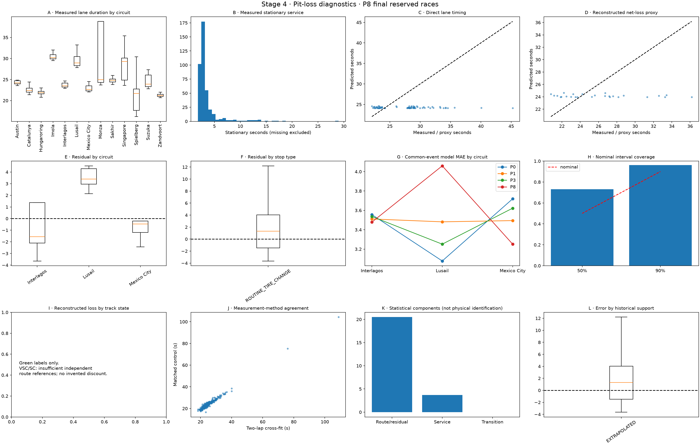
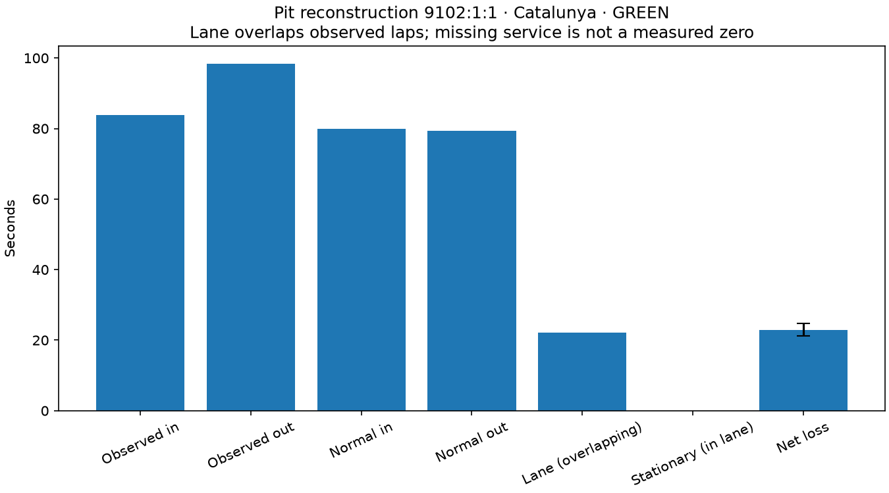
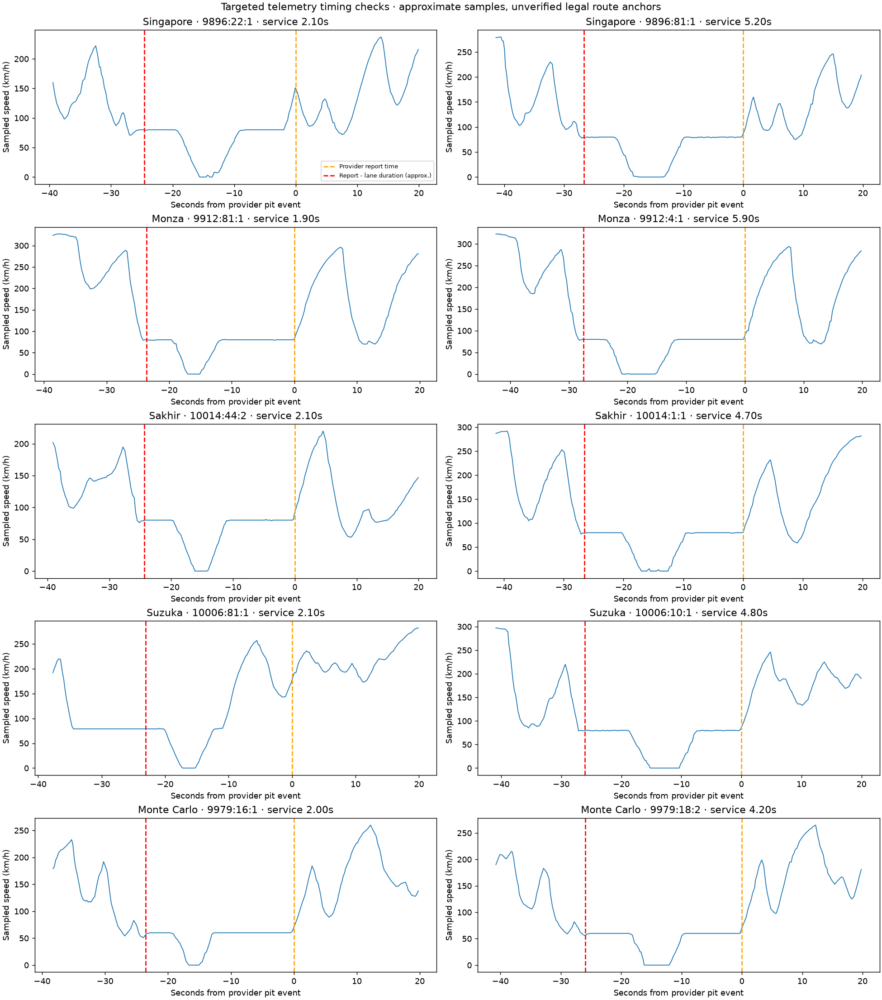

# Stage 4 — Pit-Stop Loss and Transition Intelligence: Full Report

## Assessment

The Stage 4 research pipeline is implemented, reproducible, and covered by 75 passing tests. **Stage 4 is not complete under the proposed acceptance criteria.** The advanced model has not demonstrated reliable improvement over simple baselines; neutralized-stop estimates and physical timing boundaries remain unvalidated. A further review of the saved results identified a component-evaluation defect involving mixed-state red-flag visits.

The saved green-flag result is **3.579 seconds MAE for P8 versus 3.496 seconds for the P1 circuit baseline**, evaluated on 26 common eligible events from three reserved races. Those three circuits are all unseen by the fitted pit model. This is a difficult joint chronological/circuit-transfer test, not a clean test of later races at familiar circuits.

The software tests establish important engineering invariants. They do not establish label accuracy, probability calibration, reliable exceptional-event classification, or strategy readiness.

## 1. Scope and preserved dependencies

Stage 4 adds canonical pit-event reconstruction, analytical tables, point-in-time scenario requests, counterfactual measurements, baseline and component models, predictive sampling, chronological backtesting, limited neutralization interfaces, and equal-distance integration with normal-lap trajectories.

The Stage 3 model sources, experiment configuration, and existing validation report were preserved. Their hashes are recorded in `config/experiments/stage3_frozen_reference.json`. The comparative source revision is `7b12014d341842f3ee4c7b34aaa3255deda79b2a`; Stage 4 changes remain working-tree changes. The original fitted Stage 3 artifacts were not present in the initial checkout, so this is preservation of available source/report dependencies, not a claim of bit-for-bit reproduction of missing fitted models.

The reviewed Stage 3 concerns remain open: new-stint regime 0B bias, fixed-cohort 20-lap cumulative diagnostics, and long-horizon calibration. Static inspection identified clipped old-tire reference ages and damped structural resets as plausible bias mechanisms, but no causal attribution or retuning was claimed. Stage 4 uses a separate historical normal-lap reference instead of silently absorbing that bias into pit coefficients.

Full race simulation, rejoin positions, overtaking, traffic, Safety Car queue formation, optimal stopping, and live dashboard development remain outside Stage 4.

## 2. Frozen time-accounting contract

For a verified pit-in lap and following pit-out lap:

```
net_transition_loss = observed_in_lap + observed_out_lap
                      - normal_old_tire_reference - normal_new_tire_reference

lane_duration = moving_lane_duration + stationary_service

stop_strategy_time = equivalent_normal_lap_trajectory + net_transition_loss
```

Stationary service is already inside lane duration. Lane time and net loss are parallel outputs, not additive penalties. Pace V2 owns normal clean-air lap performance; Stage 4 owns incremental entry, exit, and abnormal pit-out effects in the transition window. A second warm-up penalty would double-count those effects.

Net transition loss is a counterfactual estimate. Lane and stationary durations are source measurements when available. Relative loss to particular opponents is not established without the future multi-car simulator.

All durations use seconds and all cutoffs use timezone-aware UTC timestamps.

## 3. Data coverage

The configured experiment contains 29 sessions. Pit records were available for 27 sessions across 13 circuits. The 2023 Bahrain and Saudi Arabian pit snapshots were empty; that represents missing source coverage, not a claim that those races had no pit stops.

| Population | Configured races | Reconstructed visits | Measured service times | Eligible green proxy labels | Net-loss forecasts evaluated |
| --- | ---: | ---: | ---: | ---: | ---: |
| Training, 2023–2024 | 17 | 543 | 23 | 293 | 225 realized benchmark opportunities, not held-out validation |
| Validation, early 2025 | 4 | 154 | 152 | 56 | 43 |
| Reserved test, later 2025 | 3 | 105 | 102 | 46 | 26 |
| Regulation transfer, 2026 | 5 | 177 | 128 | 71 | 64 |
| Total | 29 | 979 | 405 | 466 | — |

The scenario benchmark generates fresh HARD/MEDIUM/SOFT requests. It scores a realized outcome only when that explicit scenario matches the observed tire choice and initial age, and the required cutoff information exists. Consequently, the 466 reconstructed labels are not 466 held-out forecast evaluations. Only 26 eligible final-test cases are used for the headline net-loss comparison.

**574 visits, or approximately 58.6%, have no measured stationary duration.** These values remain missing; they are never scored as observed zeros.

Most importantly, all **23 measured training service times come from Austin 2024**. Team-specific observed counts are only one to three stops. Partial pooling helps avoid extreme estimates, but cannot create independent race-weekend evidence that is absent.

## 4. Warehouse and event reconstruction

| Table | Meaning |
| --- | --- |
| `silver.pit_lane_reference` | Versioned circuit/layout metadata with effective periods and availability |
| `gold.pit_events` | Canonical observed visits, tire transitions, timing and quality |
| `gold.pit_transition_observations` | Event-by-method counterfactual labels and provenance |
| `gold.pit_context` | Decision cutoffs and explicitly supplied scenarios |
| `gold.pit_training_examples` | Context plus separately attached realized targets |

Visit IDs use session, driver, and deterministic chronological sequence. Reconstruction reconciles the pit record with both stint boundaries, the raw pit-out marker, and surrounding lap timestamps. Identical duplicate payloads are counted on one visit; conflicting records remain flagged.

The final event categories are 691 `VALID_ROUTINE_GREEN`, 203 `MIXED_TRACK_STATE`, 50 `VALID_ROUTINE_SC`, and 35 `AMBIGUOUS_TIMING`. There are 220 mixed transition windows when counting the underlying state independently of category precedence. Twenty-four visits are flagged as possible double stacks; that is a proximity flag, not a verified queueing diagnosis.

Circuit-season reference rows exist, but historical speed limits and exact layouts remain unverified. These rows are not made available as known forecast inputs. The current model learns historical circuit behavior rather than validated geometric route costs.

Exceptional-event classification is incomplete. Verified tire changes do not prove the absence of repairs, penalties, or garage holds. The independent annotation CSV currently supplies no populated exceptional-event evidence. A long duration alone is not assigned an invented cause.

## 5. Timing audit: the pit timestamp is not guaranteed entry

Targeted telemetry and inspection of the OpenF1 ingestor showed that the pit record can timestamp a timing-feed report after the stationary phase. Treating that timestamp as pit entry and adding lane duration produces an erroneous forward window.

The warehouse preserves the raw report timestamp and uses `[report - lane_duration, report]` only as an approximate lane window. Feed latency and legal entry/exit loops remain unverified. The two-lap counterfactual uses reconciled lap boundaries, not a claim of exact lane-entry geometry.

The provider source was inspected at revision `9cf3019aa494be0e26ffec3b34af3bd0939357c2`. Its query parser also confirmed that HTTP filter keys must be `date>` and `date<`, because the URL separator supplies the equals sign. This convention has a regression test.

## 6. Counterfactual measurements and uncertainty

The primary `TWO_LAP_CROSS_FIT` method fits compound, age and progression effects using earlier races only. It excludes the entire target race from nuisance-parameter fitting, then anchors current driver pace on at least three clean laps observed before the transition. It retains model version, training sessions, cutoffs, input hashes, support and label uncertainty.

The supporting `MATCHED_NON_PITTING_CONTROLS` method uses simultaneous uninterrupted control cars, adjusted for pre-stop target/control pace. It does not call the ridge reference, but can still be confounded by tire choices and control selection. These are complementary estimators, not randomized causal measurements.

There are 403 matched-control comparisons. Absolute disagreement is 1.083 seconds at the median, 2.069 seconds at the 90th percentile, and 2.560 seconds at the 95th percentile. Maximum disagreement is 6.866 seconds. Disagreement is retained and can inflate label uncertainty rather than being hidden by averaging or error-based filtering.

The median reported label standard deviation in the final-test population is approximately 1.009 seconds. This is an internal uncertainty estimate, not independently measured physical label accuracy.

A verified-route measurement interface exists, but no event has verified equivalent legal route anchors. Method C is therefore not historically validated.

## 7. Forecast interface and simulation ownership

The public request/response contracts include proposed tire state, intended stop lap, cutoff, circuit/team identity, track-state assumptions, model provenance, support and uncertainty. Responses contain mean, median, standard deviation, central 50%/90% intervals, predicted components, delay probability when identified, and optional retained samples.

Pre-stop mode rejects realized future service time. In-progress mode permits an observed service duration only with an observation timestamp no later than cutoff. Its remaining-loss quantity excludes the supplied consumed service; it is not a complete live moving-phase reconstruction. Historical measurement remains a separate API.

Hypothetical requests do not require an actual future pit event. Future flags are allowed only as explicit conditional scenarios, not as silently read realized timelines.

The integration adds net loss once to equal-distance normal-lap trajectories. Shared reference uncertainty has opposite signs in normal pace and observed-minus-reference pit loss, allowing it to cancel when callers actually share the same draws. Independent pace/pit samples cannot be assumed to have that dependence automatically.

## 8. Experiments and model selection

P0 is a global median-location benchmark; P1 uses circuit-specific locations; P2 adds expected service; P3 partially pools circuits/era; P4 separates route/service statistically; P5 pools team service effects; P6 enables the empirical delayed-service tail; P7 adds compound-transition residuals; P8 applies validation-only interval scaling. These are statistical components, not independently measured physical entry/exit/warm-up phases.

P9 freezes historical fitting for 2026 transfer. P10 adds strictly earlier completed 2026 races. N0–N3 expose neutralization scenario infrastructure and unsupported fallbacks, not validated historical net-loss models.

Primary selection uses race-weighted validation MAE. P2 scored 5.034 seconds versus P8's 5.341 seconds and was selected. P8 has lower event-pooled validation MAE, 2.149 versus P2's 2.257 seconds, but those are different weighting schemes. Imola has only two eligible validation cases and P8 MAE of 16.784 seconds, which matters strongly when each race receives equal weight.

The P8 calibration routine processed 43 validation cases and retained scale **1.0**. Its forecasts are therefore identical to P7 in this run. There is no demonstrated calibration gain from P7 to P8.

## 9. Reserved 2025 net-loss results

All rows below use the same 26 eligible events from Mexico, Brazil and Qatar. All three circuits are unseen by the fitted pit model, and all 26 P8 cases are classified `EXTRAPOLATED`.

| Model | Event-pooled MAE (s) | Race-weighted MAE (s) | Bias: observed minus predicted (s) | CRPS (s) |
| --- | ---: | ---: | ---: | ---: |
| P0 | 3.465 | 3.451 | +0.996 | 2.611 |
| P1 | 3.496 | 3.496 | +1.400 | 2.605 |
| P2 | 3.522 | 3.535 | +1.771 | 2.590 |
| P3 | 3.479 | 3.470 | +1.170 | 2.578 |
| P4 | 3.601 | 3.631 | +2.351 | 2.711 |
| P5 | 3.609 | 3.639 | +2.343 | 2.708 |
| P6 | 3.576 | 3.594 | +1.961 | 2.684 |
| P7 | 3.579 | 3.597 | +1.990 | 2.688 |
| P8 | 3.579 | 3.597 | +1.990 | 2.688 |

P8 is approximately 2.4% worse than P1 on pooled MAE. Its race-average MAE difference is +0.101 seconds, with a race-bootstrap 90% percentile range of −0.173 to +0.375 seconds. It improves two races and regresses on the third. Three independent races do not establish reliable superiority in either direction.

P0 has the lowest test MAE and P3 the lowest CRPS among these rows. That is descriptive, not permission to change model selection after inspecting the test set.

| P8 test circuit | Events / races | MAE (s) | Bias (s) |
| --- | ---: | ---: | ---: |
| Interlagos | 9 / 1 | 3.479 | +0.808 |
| Lusail | 8 / 1 | 4.060 | +4.060 |
| Mexico City | 9 / 1 | 3.252 | +1.333 |

Every evaluated Lusail residual is positive. This is consistent with an inadequate unseen-circuit cost prior, but does not independently identify the cause. The final test confounds chronological and unseen-circuit transfer; a later familiar-circuit holdout is still needed.

## 10. Predictive calibration and slow-stop risk

For the 26 P8 test events, 50% interval coverage is **73.1%** and 90% coverage is **96.2%**. Mean interval widths are **7.964 seconds** and **20.606 seconds**, respectively. CRPS is **2.688 seconds**, compared with P1's **2.605 seconds**.

High coverage in this small sample is not sufficient evidence of good calibration. The distributions are broad, and their probability quality does not improve on P1. The current P8 scaler can widen intervals but cannot shrink an already overwide distribution.

For slow service, defined diagnostically as more than 4.5 seconds, P8's test average predicted probability is **22.1%** versus **20.3%** observed across 74 events from three races; Brier score is **0.165**. On validation, it predicts **21.8%** versus **6.2%** observed across 113 events from four races. A close test aggregate does not establish event-level or race-stable calibration.

The selected P2 ablation excludes the delayed-service tail and predicts zero slow-stop probability. It cannot be treated as a complete simulator risk model merely because it won the primary validation metric.

## 11. Direct component timing

| Model and population | Lane events / races | Lane MAE (s) | Service events / races | Service MAE (s) |
| --- | ---: | ---: | ---: | ---: |
| P2 validation | 115 / 4 | 0.879 | 113 / 4 | 0.825 |
| P8 validation | 115 / 4 | 1.377 | 113 / 4 | 1.425 |
| P2 reserved test | 74 / 3 | 4.457 | 74 / 3 | 1.894 |
| P8 reserved test | 74 / 3 | 4.288 | 74 / 3 | 2.171 |

The test population has different circuits and stop characteristics. These results do not establish a general sub-second pit-timing model. The heavy-tail model improves representation of delayed stops, but has worse stationary-time MAE than P2 on this population; that trade-off needs explicit probabilistic model selection.

## 12. 2026 transfer and an additional evaluation defect

On 64 common eligible green-label events from five races:

| Model | Net-loss MAE (s) | Race-weighted MAE (s) | Bias (s) | 90% coverage | CRPS (s) |
| --- | ---: | ---: | ---: | ---: | ---: |
| P9 frozen historical | 2.399 | 3.256 | +0.740 | 92.2% | 1.943 |
| P10 progressive 2026 | 2.457 | 3.322 | +0.594 | 92.2% | 1.967 |

Progressive adaptation does not improve MAE or CRPS here. Its race-average MAE difference is +0.066 seconds, with a descriptive race-bootstrap 90% range of −0.051 to +0.186 seconds. Both transfer models use historical training plus validation; the 2026 scores are not a like-for-like comparison with models fitted only on the original training population.

**The direct 2026 lane-duration aggregates have a material classification/evaluation problem.** Raw lane MAE is 260.636 seconds for P9 and 260.618 seconds for P10 across 150 events from five races. Twenty-one of those visits overlap RED within mixed-state transition windows but remain eligible for direct routine evaluation. At Monza, event `11361:63:1` has recorded lane duration 1,846.2 seconds versus a roughly 24.4-second forecast.

The current classifier recognizes a pure RED state as exceptional, but mixed windows containing RED can retain the routine tire-change type. The direct-component eligibility rule then admits them. They are excluded from the green net-loss labels, so this finding does not change the reported P8 green-label comparison.

Removing RED-overlap cases only as an independently defined diagnostic leaves 129 events and lane MAE of 7.104 seconds for P9 and 7.088 seconds for P10. These are not replacement benchmark results. A further non-RED Catalunya visit, `11307:23:3`, records 777.7 seconds in lane and an 861.502-second out-lap; it also remains typed routine. The cause requires recorded evidence, not an assumption from its duration.

The next component evaluation must separate ordinary tire changes from red-flag holds, garage stays and other exceptional events, while retaining all raw records. All competing models must use the same independently defined eligibility policy. The 260-second aggregates should not be presented as ordinary-stop predictive accuracy.

## 13. Unseen-circuit and neutralization evidence

The separate leave-one-circuit-out validation contains 43 eligible labels across four races. P8 has pooled MAE **2.382 seconds**, race-weighted MAE **6.044 seconds**, and mean 90% width **20.503 seconds**. Sparse Imola cases dominate the race-weighted result. This establishes executable fallback behavior, not reliable unseen-circuit accuracy.

No VSC, SC or mixed-state net-loss model has been historically validated. N0/N1/N3 have some direct-component evaluation rows, but zero evaluable net-loss targets in those populations. N2 has no evaluated row in the saved results. These outcomes must not be reported as successful neutralization backtests.

Unsupported scenarios return wide flagged fallbacks, and the simulator helper rejects unsupported costs. Full SC queue and position effects remain a later-stage responsibility.

## 14. Targeted telemetry evidence

Ten bounded windows were acquired at Singapore, Monza, Sakhir, Suzuka and Monaco, with car-data and location samples. They confirmed the timestamp-direction issue and permit approximate stationary-phase comparisons. They do not establish legal route anchors or physical net-loss ground truth.

The representative Sakhir stop `10014:1:1` has recorded service 4.7 seconds versus a zero-speed trace midpoint of 1.62 seconds. Singapore examples also disagree by approximately 0.6–0.8 seconds. Quantized speed, internal sample gaps, source timing, and assumptions about an uninterrupted stationary phase prevent treating these estimates as precise timing loops. The discrepancies remain visible and require independent review. No event is promoted to physical reconstruction quality A.

## 15. Engineering validation and artifacts

The recorded full test run passed **75 tests**, including existing Stage 0–3 tests. Ruff, dependency consistency, and diff checks passed. Three new notebooks executed successfully. Saved model reload/prediction and model/source/frozen Stage 3 hash checks passed.

The tests cover deterministic event identities and rebuilds, pit-index reconciliation, missing service, invalid durations, track-state overlap, hypothetical requests, forecast-mode guards, future-data mutation, future-training removal, synthetic component recovery, shared uncertainty, exact penalty ownership, telemetry filter encoding, report-time semantics, and sensor gaps. The newly identified mixed-RED direct-evaluation defect is not yet covered by an adequate regression test; passing tests do not erase that defect.

Reproduction uses `f1ri stage4 --config config/experiments/stage4_pit_loss_v1.yaml` from the repository root. Missing snapshots can first be obtained with `f1ri ingest-batch --config config/experiments/stage4_pit_loss_v1.yaml`. Optional traces use `f1ri pit-telemetry-audit`.

The run retains configuration, input hashes, splits, canonical events, uncertain labels, requests, predictions, slice metrics, fitted model pickles, acceptance flags and run metadata under `artifacts/runs/stage4_pit_loss_v1/` and `artifacts/models/pit_loss_v1/`. A reviewable model manifest and figures are retained with the reports. No deployment or environment publication was performed.







## 16. Acceptance status and next work

| Requirement | Status |
| --- | --- |
| Pit-loss contracts and exact time ownership | Implemented and tested |
| Frozen available Stage 3 dependencies | Hash-verified |
| Historical visits and uncertain green labels | Implemented; measurement validity remains provisional |
| Independent matched-control checks | Implemented; agreement and confounding limits documented |
| High-frequency timing audit | Acquired; exact physical boundaries unverified |
| Historically sourced layouts and speed limits | Not completed |
| Reliable routine/exceptional classification | Incomplete; mixed-RED and long-stay defect identified |
| P8 reliably beats circuit baselines | Not demonstrated |
| Calibrated slow-stop and full-loss distributions | Not established |
| Validated VSC/SC net loss | Not completed |
| Stage 4 software test suite | 75 tests passed in the recorded run |
| Unrestricted race-strategy approval | Not granted |

Priority work is to correct event classification and component eligibility with explicit RED-overlap and long-stay regression cases; expand the independent stationary-service training population beyond one weekend; source circuit/layout metadata; validate high-quality counterfactual references and exceptional-event evidence; and add separate later familiar-circuit and unseen-circuit holdouts before inspecting their outcomes. Probabilistic selection must include tail behavior and interval sharpness, not MAE alone. Neutralized-stop modeling needs its own matched reference dataset.

Stage 5 may develop against these interfaces experimentally, but the current Stage 4 model should not yet be used as an approved race-strategy cost engine.

## Sources for this report

- `artifacts/runs/stage4_pit_loss_v1/metrics.json`
- `artifacts/runs/stage4_pit_loss_v1/data_audit.json`
- `artifacts/runs/stage4_pit_loss_v1/pit_events.parquet`
- `artifacts/runs/stage4_pit_loss_v1/pit_event_labels.parquet`
- `artifacts/runs/stage4_pit_loss_v1/predictions.parquet`
- `artifacts/runs/stage4_pit_loss_v1/telemetry_timing_checks.json`
- `artifacts/runs/stage4_pit_loss_v1/acceptance.json`
- `config/experiments/stage4_pit_loss_v1.yaml`
- `docs/STAGE4_SPEC.md`

The additional RED-overlap and P10/P9 comparisons in this report are read-only analyses of saved predictions. No model was retuned and no saved benchmark metric was replaced while preparing this report.
