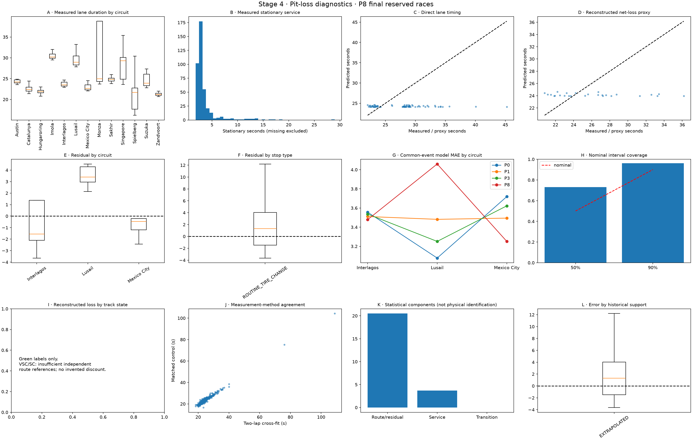
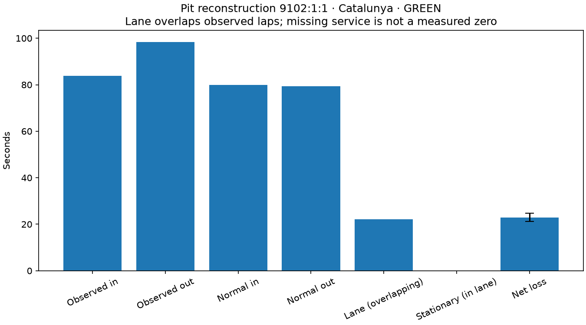
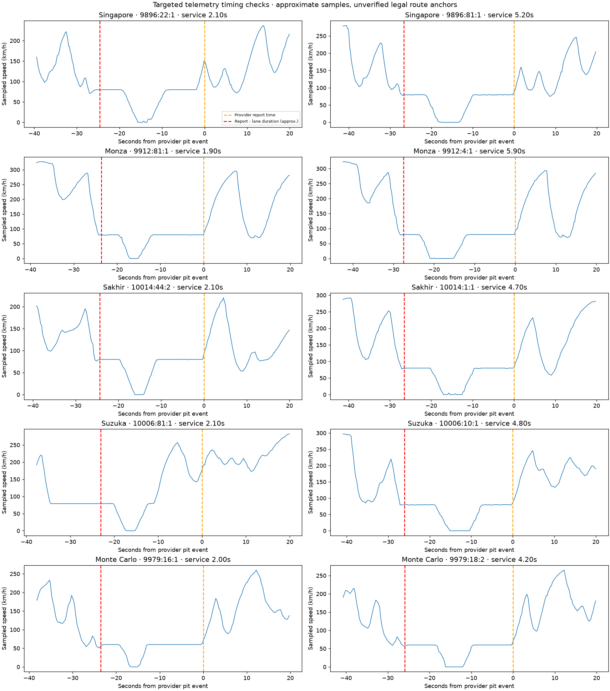

# Stage 4 — PitLoss V1 validation

Research implementation; not approved for unrestricted race-strategy optimization.

P8 reconstructed-loss MAE is 3.579s versus 3.496s for P1 on 26 common eligible events from 3 reserved races. The required reliable-improvement gate is not met; retain the simple benchmark for comparison. These races also test unseen circuits, and three independent races are too few for broad claims.

Source revision: `7b12014d341842f3ee4c7b34aaa3255deda79b2a` (working-tree implementation; see run metadata).
Run: `artifacts/runs/stage4_pit_loss_v1`. Seed 42; 1000 samples per prediction.

## Data and measurement

Timing audit finding: the OpenF1 pit timestamp is a timing-feed report, not a guaranteed pit-entry time. Independent speed traces showed stationary service preceding that record. The warehouse preserves the raw report time and marks backwards lane-window estimates as approximate; exact legal boundaries and feed latency remain unverified.

Reconstructed **979 pit events**, including 574 with no measured stationary duration. 466 two-lap loss estimates; 466 pass primary-label eligibility.

Independent matched-control checks: 403; median absolute disagreement 1.083154301377533 seconds. Both methods estimate counterfactual quantities, not physical ground truth.

Reference parameters are fitted on earlier races only, never the target race. Car pace is anchored on pre-stop clean laps. Pace V2 is frozen; its reviewed new-stint bias is not silently fitted into the pit model. Separate matched controls may still be confounded by tire choices; disagreement is retained with inflated label uncertainty.

## Chronological evaluation

Training: configured 2023–2024 races. Validation: early 2025. Newly reserved test: Mexico, Brazil and Qatar 2025 (absent from Stage 3). They include unseen circuits, so final-test results test both temporal and circuit transfer. The split manifest was written before fitting. Model selection uses validation only; P8 calibration uses validation only. A separate leave-one-circuit-out experiment uses validation races.

| Model | Split | Net events / races | Proxy MAE (s) | Bias (s) | 90% coverage | CRPS (s) | Lane MAE (s) | Service MAE (s) |
| --- | --- | --- | --- | --- | --- | --- | --- | --- |
| N0 | test | 0 / 0 | — | — | — | — | 5.247 | 2.850 |
| N0 | val | 0 / 0 | — | — | — | — | 1.615 | 0.852 |
| N1 | test | 0 / 0 | — | — | — | — | 0.079 | 0.694 |
| N1 | val | 0 / 0 | — | — | — | — | 2.068 | 0.397 |
| N3 | test | 0 / 0 | — | — | — | — | 10.415 | 5.006 |
| N3 | val | 0 / 0 | — | — | — | — | 1.388 | 1.079 |
| P0 | test | 26 / 3 | 3.465 | 0.996 | 0.962 | 2.611 | 4.196 | — |
| P0 | val | 43 / 4 | 2.731 | -0.600 | 0.977 | 1.993 | 2.847 | — |
| P1 | test | 26 / 3 | 3.496 | 1.400 | 0.962 | 2.605 | 4.236 | — |
| P1 | val | 43 / 4 | 2.338 | 0.120 | 0.953 | 1.741 | 1.203 | — |
| P10 | transfer_2026 | 64 / 5 | 2.457 | 0.594 | 0.922 | 1.967 | 260.618 | 0.827 |
| P2 | test | 26 / 3 | 3.522 | 1.771 | 0.962 | 2.590 | 4.457 | 1.894 |
| P2 | val | 43 / 4 | 2.257 | 0.484 | 0.953 | 1.750 | 0.879 | 0.825 |
| P3 | test | 26 / 3 | 3.479 | 1.170 | 0.962 | 2.578 | 4.208 | — |
| P3 | val | 43 / 4 | 2.405 | -0.176 | 0.953 | 1.747 | 1.471 | — |
| P4 | test | 26 / 3 | 3.601 | 2.351 | 0.962 | 2.711 | 4.387 | 1.894 |
| P4 | val | 43 / 4 | 2.178 | 1.003 | 0.953 | 1.782 | 1.386 | 0.825 |
| P5 | test | 26 / 3 | 3.609 | 2.343 | 0.962 | 2.708 | 4.386 | 1.894 |
| P5 | val | 43 / 4 | 2.171 | 0.977 | 0.953 | 1.772 | 1.379 | 0.823 |
| P6 | test | 26 / 3 | 3.576 | 1.961 | 0.962 | 2.684 | 4.288 | 2.171 |
| P6 | val | 43 / 4 | 2.170 | 0.556 | 0.977 | 1.815 | 1.377 | 1.425 |
| P7 | test | 26 / 3 | 3.579 | 1.990 | 0.962 | 2.688 | 4.288 | 2.171 |
| P7 | val | 43 / 4 | 2.149 | 0.588 | 0.977 | 1.809 | 1.377 | 1.425 |
| P8 | test | 26 / 3 | 3.579 | 1.990 | 0.962 | 2.688 | 4.288 | 2.171 |
| P8 | val | 43 / 4 | 2.149 | 0.588 | 0.977 | 1.809 | 1.377 | 1.425 |
| P9 | transfer_2026 | 64 / 5 | 2.399 | 0.740 | 0.922 | 1.943 | 260.636 | 0.833 |

Validation-selected model: **P2**. This selection does not establish that P8 beats circuit medians or meets final acceptance.

The reserved test was not used to tune a replacement model. Reruns after correctness fixes are regression evaluations of that same reserved set, not additional untouched evidence.

Paired final-test comparisons use identical eligible events and race-level bootstrap resampling:

```json
{
  "P0_vs_P1": {
    "n_events": 26,
    "n_races": 3,
    "race_mean_mae_delta_s": -0.0449040666632396,
    "p05_delta_s": -0.2544563777583577,
    "p95_delta_s": 0.16464824443187853,
    "races_improved": 1,
    "resampling_unit": "race"
  },
  "P2_vs_P1": {
    "n_events": 26,
    "n_races": 3,
    "race_mean_mae_delta_s": 0.03883656038623803,
    "p05_delta_s": -0.15240199848978264,
    "p95_delta_s": 0.23007511926225868,
    "races_improved": 2,
    "resampling_unit": "race"
  },
  "P3_vs_P1": {
    "n_events": 26,
    "n_races": 3,
    "race_mean_mae_delta_s": -0.025606575302050533,
    "p05_delta_s": -0.1451039267116197,
    "p95_delta_s": 0.09389077610751861,
    "races_improved": 1,
    "resampling_unit": "race"
  },
  "P4_vs_P1": {
    "n_events": 26,
    "n_races": 3,
    "race_mean_mae_delta_s": 0.135482308336812,
    "p05_delta_s": -0.32449013418965145,
    "p95_delta_s": 0.5954547508632754,
    "races_improved": 2,
    "resampling_unit": "race"
  },
  "P5_vs_P1": {
    "n_events": 26,
    "n_races": 3,
    "race_mean_mae_delta_s": 0.1435097163323432,
    "p05_delta_s": -0.3106954480814522,
    "p95_delta_s": 0.5977148807461387,
    "races_improved": 2,
    "resampling_unit": "race"
  },
  "P6_vs_P1": {
    "n_events": 26,
    "n_races": 3,
    "race_mean_mae_delta_s": 0.09868052608800719,
    "p05_delta_s": -0.17841892893519587,
    "p95_delta_s": 0.3757799811112103,
    "races_improved": 2,
    "resampling_unit": "race"
  },
  "P7_vs_P1": {
    "n_events": 26,
    "n_races": 3,
    "race_mean_mae_delta_s": 0.10099496137802999,
    "p05_delta_s": -0.17253912501631263,
    "p95_delta_s": 0.3745290477723726,
    "races_improved": 2,
    "resampling_unit": "race"
  },
  "P8_vs_P1": {
    "n_events": 26,
    "n_races": 3,
    "race_mean_mae_delta_s": 0.10099496137802999,
    "p05_delta_s": -0.17253912501631263,
    "p95_delta_s": 0.3745290477723726,
    "races_improved": 2,
    "resampling_unit": "race"
  }
}
```

## Diagnostics and artifacts





The run retains config, input hashes, splits, event labels, predictions, metrics, per-slice counts, unseen-circuit predictions and run provenance. Model pickles are local trusted outputs under `artifacts/models/pit_loss_v1/`.

## Limits and outstanding acceptance gates

- VSC/SC/mixed requests have an explicit conditional API, but no validated route-matched neutralization reference set. They return unsupported, wide fallback distributions and cannot be consumed as supported simulation costs. N0–N3 are unvalidated where targets are unavailable.
- No exact pit entry/exit geometry or historical speed limit is invented. Reference CSV rows are explicitly unverified and unavailable as of forecasts until sourced.
- High-frequency acquisition is optional and bounded to one driver and ≤180 seconds. Approximate GPS is not a legal timing loop. Telemetry validation is reported separately and does not automatically promote events to quality A.
- Repairs, drive-throughs, penalties and double-stack delays need recorded classifications. Long duration alone is never a cause label. Unclassified/ambiguous visits remain in the audit and outside primary fitting.
- The model describes observed stop-selection support, not random assignment of all possible pit decisions. Fresh-tire scenario evaluation does not claim coverage of every used-tire scenario.
- Stage 3's 0B bias, fixed-cohort 20-lap diagnostics and long-horizon calibration remain separate stabilization tasks. No Stage 3 model, existing report or experiment configuration was overwritten.
- Small independent race samples limit claims of superiority and calibration. Stage 4 final acceptance remains evidence-gated.

## Time accounting

Net loss = observed in-lap + observed out-lap − normal old-tire lap − normal new-tire lap. Stationary time is already inside lane time. Pace V2 owns normal clean-air laps; Stage 4 owns incremental pit-out transition effects. The strategy integration adds net loss once, never lane time plus net loss plus a warm-up penalty. Shared reference/route draws can be supplied across pit samples; correlated pace uncertainty must be supplied by the caller, not assumed independent.

## Independent targeted telemetry checks

Acquired 10 bounded pit windows across 5 circuits, with car-data and location samples. This verifies acquisition and permits resolution-limited stationary timing comparisons. It does not identify legal pit entry/exit anchors or validate a physical net-loss label.



Per-event source hashes, sample gaps and acquisition bounds are in `telemetry_audit.json`; stationary timing differences and boundary resolution are in `telemetry_timing_checks.json`.

| Event | Circuit | Recorded service (s) | Trace midpoint (s) | Difference (s) |
| --- | --- | --- | --- | --- |
| 9896:22:1 | Singapore | 2.1 | 1.300 | -0.800 |
| 9896:81:1 | Singapore | 5.2 | 4.599 | -0.601 |
| 9912:81:1 | Monza | 1.9 | 2.061 | +0.161 |
| 9912:4:1 | Monza | 5.9 | 5.980 | +0.080 |
| 10014:44:2 | Sakhir | 2.1 | 2.481 | +0.381 |
| 10014:1:1 | Sakhir | 4.7 | 1.620 | -3.080 |
| 10006:81:1 | Suzuka | 2.1 | 2.240 | +0.140 |
| 10006:10:1 | Suzuka | 4.8 | 5.099 | +0.299 |
| 9979:16:1 | Monte Carlo | 2.0 | 1.839 | -0.161 |
| 9979:18:2 | Monte Carlo | 4.2 | 4.320 | +0.120 |

These sensor checks assume one uninterrupted service between adjacent low-speed samples. Gaps, quantized wheel speed and source-report latency can invalidate exact duration reconstruction. Disagreements are retained, not filtered away; the large Sakhir discrepancy requires independent review. None of these events is promoted to verified physical-route quality A.
