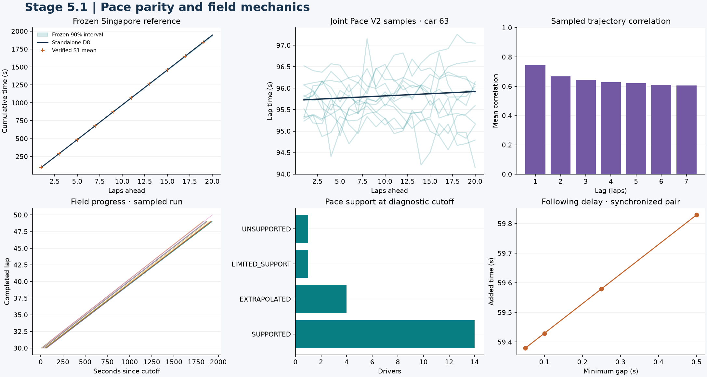
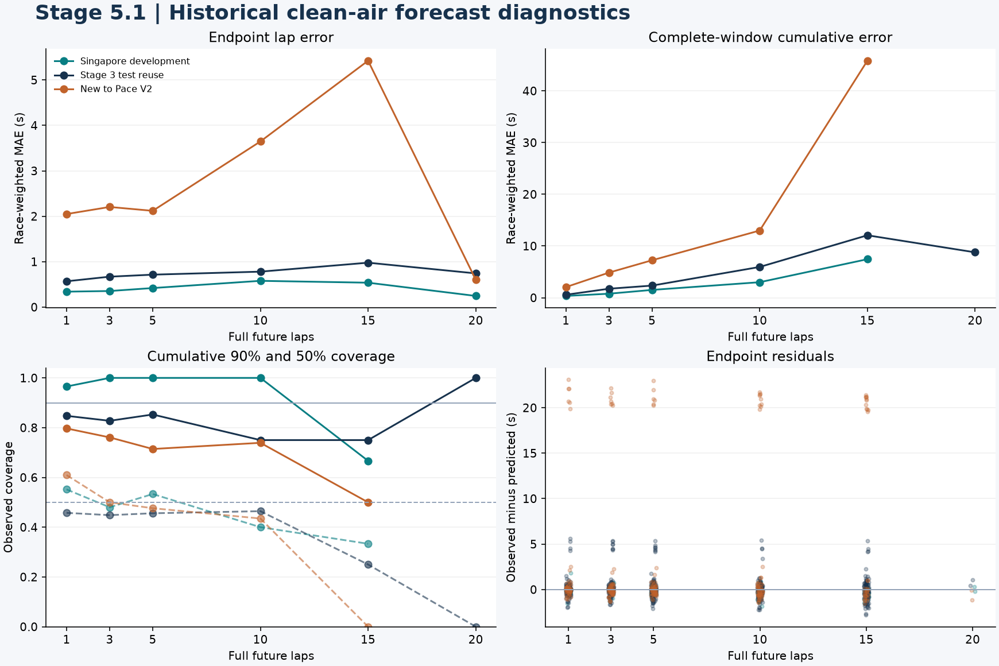

# F1 Race Intelligence Engine — Stage 5.1 Validation

## Pace V2 parity, field mechanics, and historical clean-air performance

The S1 integration reproduced all six frozen Stage 3 reference cases and ran
527 driver forecasts at 28 historical field cutoffs. The engine scheduled
100 sampled fields and one mean field at Singapore's lap-30 cutoff.
Checkpoint time was conserved in every run. The new-to-Pace cohort revealed
a large cold-start error at Baku and sparse evidence beyond ten laps.

The current capability is conditional clean-air pace simulation for the
2023–2025 era. A forecast continues the current tires under green-flag
conditions. Race outcomes, future pit decisions, and race-control events
remain outside this evaluation. [S1 specification](../../docs/STAGE5_S1_SPEC.md)

## 1. Frozen Stage 3 parity

The original `PaceV2_D8_correlated` artifact was recovered with its saved
configuration, split manifest, compound mapping, and calibration state.
The loader verifies the pinned SHA-256 before loading. The model reports a
training cutoff of **2024-10-20 20:38:45.387 UTC**. The validation split
places its latest calibration input on **2025-06-01 14:36:47.725 UTC**.

| Reference fixture | Driver and cutoff lap | Cases | Largest absolute difference |
| --- | --- | ---: | ---: |
| Singapore 2025 | Russell 20 and 30, Verstappen 40 | 3 | 0 s |
| Imola 2025 | Verstappen 10 and 20, Norris 40 | 3 | 0 s |

The fixture builder reproduced the archived Stage 3 lap means and 90%
lap and cumulative intervals before integration. The adapter reproduced
the frozen means, 50% and 90% cumulative intervals, and retained joint
sample rows. The sampler's full draw is preserved, including values beyond
the first 50 rows exposed by the standalone forecast. Imola contributed to
calibration and was used only for numerical parity. [Model manifest](../../config/experiments/stage5_s1_d8_manifest.json) · [Reference fixtures](../../tests/fixtures/stage5_s1_d8_reference.json)

## 2. Point-in-time field and timing checks

Every driver uses one shared UTC cutoff and an independently observed lap
count. The snapshot masks in-progress lap results, rebuilds clean-air
history from the observation prefix, and never joins final classification.
The regression test changes future lap durations, sector times, pit records,
weather, flags, stint endpoints, and results. The snapshot and sampled
trace remain identical. OpenF1 timestamps serve as availability proxies,
so this check establishes invariance to those mutations on the archived
feed.

At Singapore's **2025-10-05 12:52:29.272 UTC** cutoff, D8 supplied 1,000
joint trajectories each for 19 drivers. Car 18 was unsupported at the
requested horizon and was excluded from the field runs. The mean run
committed 1,117 checkpoint events and 380 completed laps. Sample zero
reproduced exactly. The scheduler conserves each lap at microsecond
resolution after apportioning time across checkpoints. In-progress sectors
are estimated from elapsed time and scenario checkpoint fractions.

The synchronized two-car following diagnostic added **59.429 s** across
20 laps at a 0.10 s minimum gap. The clean-air trajectories stayed intact.
This was an explicitly aligned shared-route scenario. Actual asynchronous
fields use free-running timing while physical order remains unresolved.



## 3. Historical validation

The configuration fixed leader-lap opportunities at 10, 20, 30, and 40
before evaluation. Singapore served as development. Austria, Hungary,
Austin, and Abu Dhabi reused the Stage 3 test cohort. The Netherlands
and Azerbaijan Grands Prix were outside the Stage 3 pace study.
Zandvoort had prior circuit data and Baku was unseen by the frozen pace
model. Four Singapore 2026 cutoffs were recorded as unsupported because
an era-matched frozen model bundle was unavailable.
[Evaluation configuration](../../config/experiments/stage5_s1_pace.yaml)

Evaluation starts at each driver's first full future lap. A completed
cumulative window requires every lap to be clean and on the same stint.
Endpoint scores can still use an eligible target after intervening traffic.
An in-progress lap consumes one model step, which limits 20-full-lap
evaluation to drivers already at the timing line. The table reports
race-weighted MAE and pooled interval coverage.

| Cohort | Horizon | Eligible endpoints | Endpoint MAE | Complete windows | Cumulative MAE | 90% cumulative coverage |
| --- | ---: | ---: | ---: | ---: | ---: | ---: |
| Stage 3 test reuse | 1 | 118 | 0.568 s | 118 | 0.568 s | 84.8% |
| Stage 3 test reuse | 5 | 128 | 0.714 s | 68 | 2.337 s | 85.3% |
| Stage 3 test reuse | 10 | 90 | 0.780 s | 28 | 5.945 s | 75.0% |
| Stage 3 test reuse | 15 | 87 | 0.977 s | 12 | 12.068 s | 75.0% |
| New to Pace V2 | 1 | 64 | 2.049 s | 64 | 2.049 s | 79.7% |
| New to Pace V2 | 5 | 56 | 2.119 s | 42 | 7.237 s | 71.4% |
| New to Pace V2 | 10 | 57 | 3.646 s | 23 | 12.987 s | 73.9% |
| New to Pace V2 | 15 | 33 | 5.424 s | 8 | 45.825 s | 50.0% |

There was one eligible 20-lap cumulative window across the reused races
and zero in the new cohort. At 15 laps the eight new-cohort windows all
came from Baku. Those counts limit conclusions about long-horizon
calibration. The run's JSON includes the 3- and 20-lap rows, CRPS, bias,
RMSE, coverage, widths, and censoring counts.

### Baku cold-start behavior

Baku's one-lap MAE was **3.805 s** across 37 eligible endpoints. The eight
with zero eligible clean laps in the current stint had **16.631 s** MAE.
The other 29 had **0.267 s** MAE. The largest observed endpoint miss was
**23.079 s**. The frozen model falls back to its global pace prior when
circuit history is unavailable, and its circuit-specific qualifying
offset also requires prior circuit data. This failure warrants an explicit
support restriction in any downstream use of unseen-circuit cold starts.
S1 preserves the existing predictions and records circuit familiarity
and prior clean-stint counts in the evaluation data.



## 4. Reproduction and scope

From a checkout with the original Stage 3 bundle and the two new races
built into the local warehouse:

```bash
f1ri stage5-s1 --stage3-root /path/to/original-stage3-project
pytest -q
ruff check src tests
```

The command writes the configuration, model and warehouse hashes, UTC
cutoffs, metrics, forecast tables, diagnostic snapshot, sampled field
summary, joint trajectories, and example trace under
`artifacts/runs/stage5_s1_pace`. The full suite passed **113 tests**
including the existing S0 replay tests. Ruff passed.

S1 passes the integration and mechanical checks. Forecasting on unseen
circuits with no usable current-stint history, long-horizon calibration,
and 2026 transfer remain open. S2 can use the verified timing and
sampling interfaces for explicitly supported green-flag pit scenarios.
