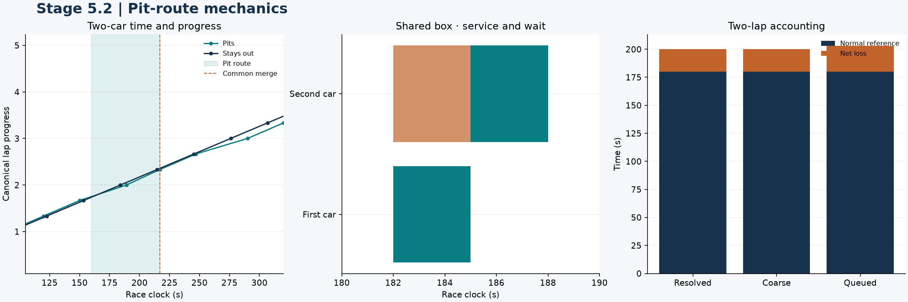
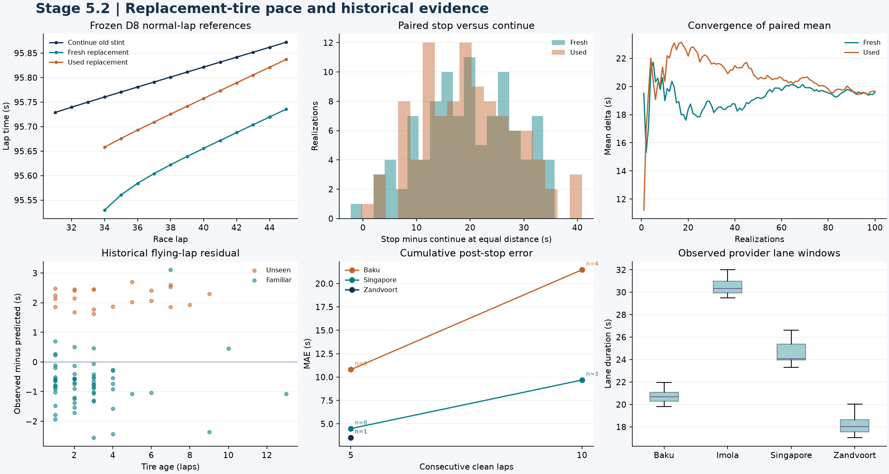

# F1 Race Intelligence Engine — Stage 5.2 Validation

## Pit accounting, tire transitions, and rejoining

The simulator now executes declared pit routes and coarse net-loss stops,
switches to a new Pace V2 stint, and records whether a merge can be
resolved. The synthetic timing checks and fresh/used D8 parity passed.
The original locked P1 model file was unavailable, so live P1 parity and
historical P1 forecasting remain open. [Stage 5.2 specification](../../docs/STAGE5_S2_SPEC.md)

## 1. Mechanical pit accounting

The two-car fixture used 90 s normal laps for the pitting car and 92 s
for its opponent. The resolved stop diverted after sector 2 and crossed
the timing line on the pit route. A 29 s lane interval contained 3 s of
stationary service. The old racing itinerary was invalidated at diversion.
The replacement tires retained their four-lap starting age through the
pit-route crossing that ended the old stint. Completing the out-lap
advanced them to age five.

| Scenario | Normal two-lap reference | Elapsed two-lap time | Net loss |
| --- | ---: | ---: | ---: |
| Resolved stop | 180 s | 200 s | 20 s |
| Coarse stop | 180 s | 200 s | 20 s |
| Second car in the same box | 180 s | 203 s | 23 s |

The opponent reached the common merge marker **2.333 s** before the
pitting car, reversing their order from in-lap sector 2. The event was
classified as a pit-cycle position change. Exact ties, overlapping timing
uncertainty, and overlapping coarse windows yield unresolved order.
The coarse stop carries no physical entry, service, exit, or merge
timestamps. The double stack holds one car in the box at a time and
includes the three-second wait in elapsed loss once.



## 2. Replacement tires and paired D8 timing

Fresh and previously used sets reproduced standalone D8 means,
uncertainty summaries, and retained draws. A no-stop scenario reproduced
the S1 trace. In a stop scenario the old-stint sample is unchanged up to
the pit. The new stint retains cutoff-known race pace and clears the old
set's tire-specific observations. D8 supplies separate stochastic draws
for each stint because its saved interface does not expose a transferable
random car effect. The S2 adapter leaves the frozen fitted model unchanged.

The Singapore scenario used the lap-30 field cutoff
**2025-10-05 12:52:29.272 UTC**. Car 63 stopped on lap 33 for mediums with
either zero or three laps of prior use. Both scenarios used a declared
22 s synthetic loss and the same 15-lap distance as continuing.

| Replacement set | Mean-pace stop minus continue | 90% sample interval | Paired runs |
| --- | ---: | ---: | ---: |
| Fresh mediums | +19.918 s | +4.50 to +33.20 s | 100 |
| Used mediums, age three | +21.191 s | +6.55 to +33.89 s | 100 |

The difference combines the change in clean-air pace with the single
synthetic pit cost. The simulation leaves precise rejoin order unresolved
for both scenarios. [Experiment configuration](../../config/experiments/stage5_s2_pits.yaml)

## 3. Historical replay and post-stop pace

| Race | Recorded lane windows replayed | Official lap counts matched | Classified positions matched |
| --- | ---: | ---: | ---: |
| Singapore 2025 | 23/23 | 20/20 | 20/20 |
| Imola 2025 | 37/37 | 20/20 | 18/18 |
| Netherlands 2025 | 39/40 | 20/20 | 6/18 |
| Azerbaijan 2025 | 21/21 | 20/20 | 16/19 |

The provider windows remain approximate. None establishes an independent
physical merge. In the Netherlands replay, 14 lap boundaries around laps
68–69 disagreed by more than one second, and one pit window was unusable.
Azerbaijan had a chequered-time disagreement and an ambiguous pit-lap
mapping. The audit preserves those discrepancies and the official
comparisons. Imola contributed to D8 calibration and served only as a
replay fixture.

Post-stop forecasts used observations through the start of each in-lap.
The observed replacement compound and age were supplied as explicit
conditions for the historical comparison. The 84 visits from Singapore,
the Netherlands and Azerbaijan yielded **43 forecasts**, with 37 visits
excluded by the historical timing and track-state screen and four Baku
requests rejected for unseen-circuit initialization without clean race
pace. The first eligible lap may occur after intervening traffic.
Cumulative scores require a complete clean window immediately after the
out-lap.

| Cohort | Target | Eligible | Race-weighted MAE | 90% coverage |
| --- | --- | ---: | ---: | ---: |
| Singapore development | First eligible flying lap | 18 | 1.104 s | 66.7% |
| New to Pace V2 | First eligible flying lap | 15 | 1.491 s | 46.7% |
| Singapore development | Five consecutive clean laps | 8 | 4.492 s | 75.0% |
| New to Pace V2 | Five consecutive clean laps | 6 | 7.162 s | 16.7% |
| New to Pace V2 | Ten consecutive clean laps | 4 | 21.474 s | 0.0% |

The four ten-lap new-cohort windows all came from Baku. Among first
eligible flying laps, Baku's eight forecasts were **2.269 s too fast on
average**. Zandvoort's seven had **0.713 s MAE**. The cold-start gate
removed the unsupported cases while leaving substantial post-stop error
on the remaining unseen-circuit forecasts.



## 4. P1 status and reproduction

The P1 adapter accepts only the model whose SHA-256 matches the Stage
4.1 selection record. It consumes pre-stop green-flag inputs and returns
the provisional expected net cost in coarse mode. A synthetic fitted P1
fixture verified the adapter's expected-cost parity and support flags.
The actual selected pickle was unavailable in the workspace, so these
results contain zero locked-P1 executions. Historical P1 accuracy,
coupled pace/pit uncertainty, and exact historical rejoin order remain
unevaluated here. [Stage 4.1 selection record](stage4_1_stabilization_manifest.json)

```bash
f1ri stage5-s2 --stage3-root /path/to/original-stage3-project
pytest -q
ruff check src tests
```

The command writes metrics, eligibility, paired samples, pit-transition
records, and a synthetic event trace under `artifacts/runs/stage5_s2_pits`.
Use `--p1-artifact` when the original file is available. The full suite
passed **131 tests**, including the prior 113. The S2 leakage test mutates
the actual future tires, service and result while the planned stop remains
fixed. Ruff passed.
