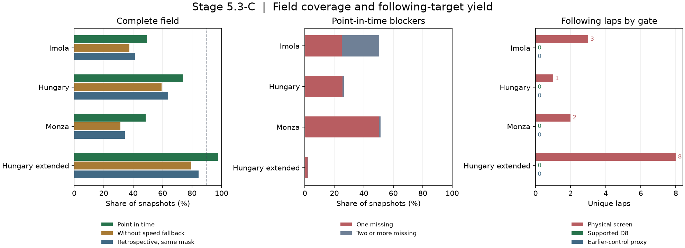

# Stage 5.3-C — Field coverage and following-target readiness

The Hungary extension reached **2,810 of 2,877 complete snapshots
(97.7%)** and yielded **eight following laps**. On the 1,276 timestamps
shared with the original windows, the two replays agreed on all 1,247
complete snapshots. The higher aggregate coverage reflects the selected
blocks. Every following lap still lacked a supported D8 reference.
**`T1_DETERMINISTIC_NO_PASS` remains operational. Traffic V1 stays
`RESEARCH_ONLY`.**

The frozen continuation reproduced 624 of 629 previous-driver checks,
4,380 of 7,656 complete point-in-time snapshots, 94 screened laps, six
following laps, 21 supported D8 references, and zero following targets or
earlier-control proxies. Its metrics and the Singapore pilot metrics
matched byte for byte. The hash checks covered the Singapore lock's
22 files and 44 source snapshots, the three continuation geometries and
their bounded source snapshots, and the frozen Stage 3 D8 bundle.
[Original metrics](stage5_s3_c_metrics.json) · [Singapore lock](stage5_s3_c_pilot_lock.json)

## Paired coverage on the original windows

All four modes use the same 7,656 timestamps, declared roster, and
geometry. The matched retrospective mode shares the point-in-time
route mask. The native retrospective mode retains archived pit evidence.
Timing checks use the common projected passage trace. The speed fallback
affects simultaneous position estimates.

| Race | Point in time | Without speed fallback | Retrospective, same mask | Native retrospective | One missing car in point in time |
| --- | ---: | ---: | ---: | ---: | ---: |
| Imola | 1,264 / 2,552 | 959 / 2,552 | 1,054 / 2,552 | 1,036 / 2,552 | 643 |
| Hungary | 1,878 / 2,552 | 1,516 / 2,552 | 1,626 / 2,552 | 1,565 / 2,552 | 655 |
| Monza | 1,238 / 2,552 | 802 / 2,552 | 876 / 2,552 | 860 / 2,552 | 1,280 |

One missing car blocked 2,578 of 3,276 incomplete point-in-time
snapshots. Car 31 at Imola blocked 632 alone, car 87 in Hungary blocked
630, and car 14 at Monza blocked 1,250. Together they account for 97.4%
of single-car blockers. Stale lap evidence dominated those rows. The
replay kept these cars unknown where it lacked time-supported status
evidence and retained Monza car 27's separate formation-lap retirement
evidence. The full-field label rule remains in force.

Speed fallback recovered 1,103 complete snapshots and lost none. On
50,585 jointly resolved driver-level comparisons where both fields were
complete, speed on and speed off agreed on every neighbor identity.
Against the matched-mask retrospective mode, point in time alone was
complete on 830 snapshots, retrospective alone on six, and both on
3,550. Unusable brackets accounted for 8,659 retrospective driver-level
losses. Only five of the 824 net additional complete snapshots occurred
in the first or last second of a window. The native retrospective mask
differed on 553 snapshots.

The two same-mask reconstruction modes agreed on all 52,514 jointly
resolved neighbor identities when both fields were complete. Their
same-identity gap differences had a p90 of 2.36–2.77 m by race. They
disagreed on the 120 m upper-bound threshold for 519 of those comparisons
and on the 225 m lower-bound threshold for 189. This agreement uses
shared observations. At the independently timed control line, three
predecessor checks were unresolved and two had the wrong driver. Matched
passage-gap MAE was 0.078–0.082 s by race, with heuristic bounds covering
623 of 624 matched gaps.

| Held-out fix replay across original races | Age | Scored / requested | Error p90 | Median full bound width |
| --- | --- | ---: | ---: | ---: |
| Point in time without fallback | 0–0.25 s | 6,970 / 7,020 | 7.28 m | 20.68 m |
| Point in time without fallback | 0.25–0.50 s | 7,102 / 7,920 | 14.18 m | 25.24 m |
| Point in time using speed fallback | 0.25–0.50 s | 806 / 806 | 11.59 m | 35.31 m |
| Retrospective, same mask | 0.25–0.50 s | 7,665 / 7,920 | 7.09 m | 18.00 m |

The speed-assisted row is the subset where fallback was used. These
checks withhold fixes from the same location source. Live arrival latency
and simultaneous absolute gap accuracy remain unverified.
[Coverage, loss slices, comparisons and error tails](stage5_s3_c_coverage_diagnostics.json)



## Bounded Hungary extension

The plan chose one original anchor from each stratum and added 300 s
before and 20 s after. The three blocks total 1,440 s. Four original
windows supplied 640 s, including a second original window inside the
clean-seeded block. New source queries covered 800 additional field
seconds. Including one-second overlaps at internal joins, 18 location
and speed requests covered 812 s per endpoint. The merged archive
contained 110,080 location and 107,760 speed observations. Deduplication
removed 920 repeated rows per endpoint and found zero cross-slice
conflicts. No new race or reserved outcome entered the pilot.
[Frozen acquisition plan](../../config/experiments/stage5_s3_c_coverage_pilot.yaml)

| Stratum | Original anchor full laps → following | Extended cutoff cohort | Extended full laps → screened → following | Supported D8 following | Earlier-control proxy |
| --- | ---: | ---: | ---: | ---: | ---: |
| Close seed | 20 → 0 | 110 | 91 → 28 → 7 | 0 | 0 |
| Clean seed | 18 → 0 | 112 | 93 → 32 → 1 | 0 | 0 |
| Random green | 18 → 0 | 117 | 97 → 30 → 0 | 0 | 0 |
| All blocks | 56 → 0 | 339 | 281 → 90 → 8 | 0 | 0 |

The full original cohort recorded 890 cutoffs, 460 left-truncated
window entries, and 458 right-truncated outcomes. The extension recorded
339 cutoffs, 60 left-truncated entries, and 58 right-truncated outcomes.
Among the 281 full extension laps, 157 failed physical coverage,
20 crossed a pit or stint transition, and 14 were censored on archived
pass indications. Exact pass times remain unverified.

The extension matched 234 of 238 eligible control-line predecessor
checks. Matched gap MAE was 0.083 s, with bounds covering all 234
matched gaps and a median half-width of 0.495 s. It resolved 15 of 16
timing-marker checks, with 0.064 s MAE on those resolved. The missing
sector marker leaves the four-driver timing gate incomplete. On the
shared original grid, all 19,387 jointly resolved neighbor comparisons
within complete fields agreed. Its 1,125 episode
fragments contained 19,173 half-second segments. Localization loss
ended 901 fragments. One driver–leader pair contributed 105 fragments.
The eight following laps came from four drivers in four stints and four
driver–leader–stint groups. Two groups contributed three laps each.

The whole-race warehouse already supplied usable pre-cutoff history for
33 D8 references in the extension, covering nine controls and 24
intermediate laps. The eight following laps each had zero earlier
clean laps on the same stint at their cutoff. The largest eligible
earlier-control match count was four, below the frozen minimum of five. The
extension's cutoff table and eligibility ledger retain the episode
identity, availability clocks, rejected D8 rows and signed residuals
where supported. Hungary and Monza appeared in the reported Stage 3
test cohort. D8 selection and calibration used the earlier validation
cohort, which included Imola.
[Stage 3 split and selection evidence](stage3_validation.md)

## Reproduction

```powershell
$env:PYTHONPATH = "$PWD/src"
$py = 'C:/Projects/f1-race-intelligence/.venv/Scripts/python.exe'
$wh = 'C:/Projects/f1-race-intelligence/data/warehouse/f1ri.duckdb'
$d8 = 'C:/Projects/f1-race-intelligence'
& $py -m f1ri.cli stage5-s3-continue --warehouse $wh --stage3-root $d8 --output artifacts/runs/stage5_s3_c_postchange_replay
& $py -m f1ri.cli stage5-s3-continue --warehouse $wh --stage3-root $d8 --coverage-pilot config/experiments/stage5_s3_c_coverage_pilot.yaml --output artifacts/runs/stage5_s3_c_coverage
& $py -m f1ri.cli stage5-s3 --warehouse $wh --output artifacts/runs/stage5_s3_diagnostic_pilot_postchange
& $py -m pytest -q
```

The cached replay writes full per-snapshot and driver attribution in
`coverage_snapshots.parquet` and `coverage_driver_snapshots.parquet`,
including the declared roster and recorded off-track evidence.
`coverage_loss_slices.parquet` groups losses by window, stratum, driver,
last observed sector, age and reason. `lap_cutoff_cohort.parquet` and
`lap_eligibility_ledger.parquet` retain the prediction cohort and realized
screens. The archive uses `OBSERVATION_TIMESTAMP_PROXY` throughout.
Use `--ingest` to retrieve missing bounded inputs. All 164 tests passed
with the 14 existing NumPy warnings in the pit-neutralization fixture.

## Readiness

| Race and role | Physical following laps | Supported D8 following | With earlier-control proxy | Protocol gate |
| --- | ---: | ---: | ---: | --- |
| Imola, reconstruction only | 3 | 0 | 0 | D8 calibration race |
| Austria, development | — | — | — | Outside this pilot |
| Hungary, original development | 1 | 0 | 0 | Following reference absent |
| Hungary, extended development | 8 | 0 | 0 | One unresolved timing marker and no following reference |
| Monza, fixed validation | 2 | 0 | 0 | Following references absent |
| Austin, later validation | — | — | — | Outside this pilot |

No development or later validation race clears its current target gate.
The next development decision is whether a preregistered window cohort
with independently verified earlier clean-stint history can support the
existing lap and race minimums. Deterministic no-pass remains operational.
Empirical fitting, T0–T3 comparisons, model selection, and dynamic queue
and pit integration are deferred. Reserved outcomes remain sealed.
