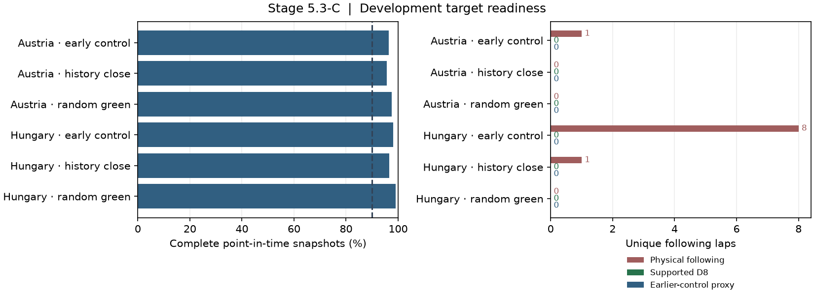

# Stage 5.3-C — Clean history and matched-control readiness

The bounded Austria–Hungary study found **ten physical following laps**.
None had three earlier clean laps on the same stint at the prediction
cutoff. The two history-qualified blocks per race found prospective close
anchors with verified clean history, but none of the four anchors became
a supported following target. Both circuits passed the four-driver timing
gate. `T1_DETERMINISTIC_NO_PASS` remains operational and Traffic V1 stays
`RESEARCH_ONLY`.

## Frozen evidence and the Hungary timing gap

The Singapore metrics, original continuation metrics, and previous Hungary
extension diagnostic reproduced byte for byte. The extension retained
2,810 of 2,877 complete snapshots, with 1,247 of 1,276 complete on the
shared grid and identical completeness decisions. Its 281 full laps
yielded 90 physical opportunities, eight following laps, 33 supported D8
references across outcomes, and zero following references or proxies.
The frozen D8 hash is
`31734c2244b3bdbd555c1407fe62207b3edf0eaddafe85e722b2cc936c75923c`.
Training ended October 20, 2024 at 20:38:45.387 UTC. The selection and
calibration cohort ended June 1, 2025 at 14:36:47.725 UTC. The verified
Stage 3 split lists Austria and Hungary as test races and Imola in the
validation cohort used for selection and calibration.
[Singapore lock](stage5_s3_c_pilot_lock.json) · [Frozen extension](stage5_s3_c_coverage_report.md) ·
[Stage 3 provenance](stage3_validation.md)

The eight frozen Hungary following cutoffs had 4–13 completed same-stint
laps each. All 86 cutoff–prior-lap records had the Stage 1 `TRAFFIC`
exclusion. Those records cover 41 distinct driver-laps. The cached physical
screen agreed on four distinct laps and abstained on 37. The ledger
records both completion clocks, stint assignment, classification and
physical timing gaps, pass indications and other exclusions. It provides
no evidence for changing the frozen history definition.
[Prior-lap evidence](stage5_s3_c_history_prior_laps.json)

For car 5 on lap 29, the sector 2 clock was 13:43:05.547 UTC and the
geometry marker was at 3,285.47 m. The consecutive racing-route fixes
straddled the marker at 13:43:04.689 and 13:43:05.728. Their 1.039 s
separation exceeded the 1.0 s passage bracket limit. Diagnostic linear
interpolation lands 0.068 s early, inside the 2 s matching tolerance.
The official replay still counts the check as unresolved, leaving the
previous Hungary extension at 15 of 16 markers. The geometry and matching
rules were preserved. [Marker trace and input hashes](stage5_s3_c_history_metrics.json)

## Development acquisition and yield

The plan froze the race keys, seed, cutoff population, arm order and
budget before acquiring the new blocks. It used two 320-second blocks
each for early controls and history-qualified close opportunities, plus
one seeded random green block per race. Austria used 20 field requests
and two geometry requests. Hungary used 14 field requests and reused its
existing geometry. The planned new field-query spans were 1,610 s and
776 s respectively per endpoint, including seam overlaps. All ten blocks
were acquired. The replay labels timestamps as
`OBSERVATION_TIMESTAMP_PROXY`.
[Preregistered plan](../../config/experiments/stage5_s3_c_history_pilot.yaml) ·
[FIA Spielberg centreline map](https://www.fia.com/system/files/decision-document/2025_spielberg_event_-_circuit_map_-_spielberg_2025_0.pdf) ·
[Austria geometry](stage5_s3_c_history_geometry_9955.json)

| Race | Eligible cutoffs | Fresh close signal | Prefix histories checked | Passed history | Rejected by phase, early / middle |
| --- | ---: | ---: | ---: | ---: | ---: |
| Austria | 633 | 185 | 72 | 16 | 36 / 20 |
| Hungary | 780 | 259 | 72 | 15 | 34 / 23 |

Austria's checked pool went from 16 drivers and 24 driver–stints to eight
drivers and nine driver–stints. Hungary went from 19 drivers and 27
driver–stints to six drivers and six driver–stints. The 56 Austria
rejections comprised 46 medium, seven hard and three soft cutoffs. The
57 Hungary rejections comprised 30 medium, 26 hard and one soft. The
machine-readable results include the cutoff selection and the driver
and stint identities lost at that screen.

| Race and arm | Complete snapshots | Full laps | Physical following / controls | D8 all / following | Independent following groups | Timing markers |
| --- | ---: | ---: | ---: | ---: | ---: | ---: |
| Austria early control | 1,232 / 1,278 | 122 | 1 / 1 | 5 / 0 | 1 | 8 / 8 |
| Austria history close | 1,222 / 1,278 | 117 | 0 / 14 | 39 / 0 | 0 | 8 / 8 |
| Austria random green | 623 / 639 | 57 | 0 / 1 | 27 / 0 | 0 | — |
| Hungary early control | 1,254 / 1,278 | 120 | 8 / 5 | 11 / 0 | 3 | 8 / 8 |
| Hungary history close | 1,234 / 1,278 | 113 | 1 / 15 | 16 / 0 | 1 | 8 / 8 |
| Hungary random green | 633 / 639 | 57 | 0 / 5 | 15 / 0 | 0 | — |

Of 586 full laps, 313 failed physical support, 44 were censored on
archived pass indications, and 32 crossed a pit or stint transition.
The remaining 197 were physically screened opportunities. The
same-stint history requirement eliminated all ten following laps from
D8 support.

Austria matched 283 of 284 eligible control-line predecessors and scored
16 of 16 timing markers at 0.129 s MAE. Hungary matched 274 of 277
predecessors and scored 16 of 16 markers at 0.069 s MAE on the new blocks.
The random blocks contributed coverage and lap outcomes. The four-driver
marker quota had already been filled in the other arms. Race-level
physical following counts were one and nine, representing one and four
conservative independent groups. The grouping counts one follower,
cutoff leader and stint per race. It cannot gain support from repeated
laps or fragments of the same group.

Of the four history-qualified anchors, two failed the physical support
screen and two were censored on archived pass indications. Both
history-close arms still produced clean controls from other cars in
their blocks. The random arm produced zero physical following laps in
either race. Its two blocks contributed 42 supported D8 references
across controls and intermediate laps.



## Earlier controls

The eligibility ledger keeps the prediction cohort separate from realized
lap screens. It preserves incomplete laps, pit or stint transitions,
archived pass indications, episode continuity and unsupported pace rows.
For each supported residual the control ledger records attrition through
development membership, distinct lap, earlier completion, earlier
evidence, compound, tire age and race progress. An unattempted match has
null counts. An attempted match with no eligible controls has a zero.
The matching code uses archived clocks, so Hungary cannot supply an
earlier Austria cutoff. The signed residual and the observational proxy
retain their signs. Shared laps use the newer replay's evidence. The
combined pool excluded 27 original rows covered by the frozen Hungary
extension and 49 additional frozen rows covered by the new study grid.
Monza retained its original validation evidence and control pool.
[Eligibility ledger](stage5_s3_c_history_eligibility.json) ·
[Control attrition](stage5_s3_c_history_control_attrition.json) ·
[Frozen control attrition](stage5_s3_c_history_frozen_control_attrition.json)

Hungary's five clean-control proxies came from the early-control arm
(one) and history-close arm (four). Its random arm produced none. The
Hungary arms also produced one, five and two intermediate-lap proxies,
respectively. Austria produced zero proxies across its three arms.
The frozen Hungary control pool supplied at most four earlier eligible
controls to any one supported lap. The new pool could supply up to ten.

## Reproduction

```powershell
$env:PYTHONPATH = "$PWD/src"
$py = 'C:/Projects/f1-race-intelligence/.venv/Scripts/python.exe'
$wh = 'C:/Projects/f1-race-intelligence/data/warehouse/f1ri.duckdb'
$d8 = 'C:/Projects/f1-race-intelligence'
& $py -m f1ri.cli stage5-s3 --warehouse $wh --output artifacts/runs/stage5_s3_history_pilot_regression
& $py -m f1ri.cli stage5-s3-continue --warehouse $wh --stage3-root $d8 --coverage-pilot config/experiments/stage5_s3_c_coverage_pilot.yaml --output artifacts/runs/stage5_s3_c_history_baseline
& $py -m f1ri.cli stage5-s3-continue --warehouse $wh --stage3-root $d8 --history-pilot config/experiments/stage5_s3_c_history_pilot.yaml --history-baseline artifacts/runs/stage5_s3_c_history_baseline --output artifacts/runs/stage5_s3_c_history_final
& $py -m pytest -q
```

The initial acquisition used `--ingest` with the same history plan.
The final command reuses the cached bounded slices. Input, geometry and
telemetry hashes are recorded in the run metrics. The full test suite
passed 169 tests, with 14 existing pit-neutralization warnings.
[Study metrics and acquisition provenance](stage5_s3_c_history_metrics.json)

## Readiness decision

| Race | Timing gate | D8 following | Following proxies | Clean-control proxies | Qualifying independent encounters | Decision |
| --- | --- | ---: | ---: | ---: | ---: | --- |
| Austria, development | Pass | 0 | 0 | 0 | 0 | Following history and earlier controls are binding |
| Hungary, development | Pass | 0 | 0 | 5 | 0 | Following history is binding |
| Monza, fixed validation | Pass | 0 | 0 | 0 | 0 | Following support absent |
| Austin, later validation | Sealed | — | — | — | — | No new outcomes opened |

The next study should preregister a larger cutoff-only screen for drivers
transitioning from a clean stint segment into close traffic. The selection
should retain the same three-lap history rule and report prospective anchor
conversion before adding further acquisition. Continue to require two
eligible development races, two later validation races and three reserved
test races. This increment leaves the T0–T3 comparison, empirical fitting,
model selection and dynamic integration deferred.
