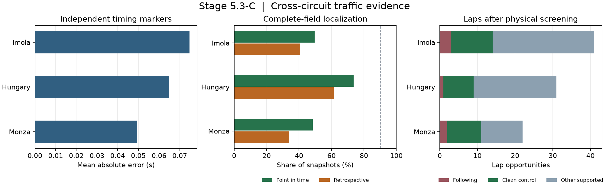

# Stage 5.3-C — Cross-circuit traffic research

## Results

The initial continuation batch covered Imola, Hungary, and Monza. Across the
three races it matched 624 of 629 eligible previous-driver checks at the
control line. The lap screen produced 94 physical opportunities, including
six following laps. The frozen Pace V2 reference supported zero of those
following laps. Empirical fitting remains gated, with
deterministic no-pass following retained as the simulator baseline.

The Singapore pilot was reproduced with a byte-identical metrics file.
The frozen manifest records its original 148-test baseline, geometry,
timing masks, outputs, and 44 immutable telemetry hashes. The continuation
tests add bounded field acquisition, cutoff-safe speed and retirement
evidence, exposure boundaries, and chronological residual matching.
[Frozen Singapore manifest](stage5_s3_c_pilot_lock.json) ·
[Continuation protocol](../../docs/STAGE5_S3_C_PROTOCOL.md)

## Cross-circuit reconstruction

Each race supplied eight disjoint 160-second green windows. The sampling
included two Stage 1 close seeds, two clean seeds, and four random green
windows per race. OpenF1 returned 292,820 usable location rows and 287,200
speed rows across the field windows. Of the location rows, 292,742 mapped
to a racing loop. Mapping success measures whether a sample projects onto
the loop. A supported simultaneous field requires a current estimate for
every required car.
[OpenF1 telemetry documentation](https://openf1.org/docs/#location) ·
[Bounded acquisition manifest](stage5_s3_c_acquisition_manifest.json)

| Race | Timing markers checked | Marker MAE | Previous-driver matches | Matched passage-gap MAE | Point-in-time complete field |
| --- | ---: | ---: | ---: | ---: | ---: |
| Imola | 16 / 16 | 0.075 s | 223 / 225 | 0.079 s | 1,264 / 2,552 (49.5%) |
| Hungary | 16 / 16 | 0.065 s | 218 / 221 | 0.082 s | 1,878 / 2,552 (73.6%) |
| Monza | 16 / 16 | 0.049 s | 183 / 183 | 0.078 s | 1,238 / 2,552 (48.5%) |

The timing checks use four held-out drivers per circuit and a separately
recorded lap-timing stream. Previous-driver matches refer to successive
passages at the same control line. They provide evidence for physical
order at that marker. The full-field results show how often the method
can estimate simultaneous racing positions across the sampled windows.

The dropped-fix check gave mean errors of 4.42 m at Imola, 4.48 m at
Hungary, and 4.39 m at Monza on supported checks. It compares estimates
with withheld projections from the same location source. The timing-gap
bounds had median half-widths of 0.44–0.49 s across circuits. The dashed
line in the figure marks the 90% engineering coverage target.
Calibration of position intervals and availability under live feed delays
remain unverified.



The Imola and Hungary loops used lap 4. At Monza, the lap-5 reference
failed the original 100 m continuity check, so the geometry used lap 6.
Its sampling plan stayed anchored to the original clock. The Monza
broadcast documents Hülkenberg returning to the pits on the formation lap.
The field retained his row as off track after the declared 13:06 UTC
availability bound. Cars without time-supported status evidence stayed
unknown when their lap records became stale. The point-in-time estimator
could use a recent archived speed observation when the last two positions
could not support velocity. These estimates retained the speed timestamp
and a wider uncertainty bound.
[Imola circuit map](https://www.fia.com/system/files/decision-document/2025_emilia_romagna_grand_prix_-_race_director_event_notes_-_circuit_map_pit_lane_emergency_exits_quarantine_zone_and_red_zones.pdf) ·
[Hungaroring circuit map](https://www.fia.com/system/files/decision-document/2025_budapest_event_-_circuit_map_-_budapest_2025_0.pdf) ·
[Monza circuit map](https://www.fia.com/system/files/decision-document/2025_monza_event_-_circuit_map_-_monza_2025.pdf) ·
[Formation-lap broadcast](https://www.formula1.com/en/video/2025-italian-grand-prix-hulkenberg-forced-to-retire-on-the-formation-lap.1842611125141941376)

[Imola sampled loop](stage5_s3_c_geometry_9987.json) ·
[Hungaroring sampled loop](stage5_s3_c_geometry_9928.json) ·
[Monza sampled loop](stage5_s3_c_geometry_9912.json)

## Following, clean controls, and the D8 reference

| Race | Episode fragments | Full laps inside windows | Following laps | Clean controls | Laps with supported D8 |
| --- | ---: | ---: | ---: | ---: | ---: |
| Imola | 429 | 148 | 3 | 11 | 0 |
| Hungary | 817 | 146 | 1 | 8 | 13 |
| Monza | 494 | 138 | 2 | 9 | 8 |

The episode dataset contains 1,740 fragments and 28,719 half-second
segments. Localization loss ended 1,388 fragments. These are dependent
observations, so the fragment count cannot stand in for independent
interactions. Of 432 full laps inside windows, 302 failed the physical
screen, 24 had archived pass indications, and 12 had pit or stint
transitions. A following lap had to continue the same encounter seen at
the cutoff. Four preliminary candidates had only a different or later
episode and were grouped with the other supported laps. Archived pass
indications provide conservative censoring. Exact pass boundaries remain
unverified.

The frozen D8 bundle was hash-verified. Imola was screened out of pace
target construction because it contributed to D8 calibration. All three
following opportunities in Hungary and Monza lacked three earlier clean
laps on the same stint. The 21 supported D8 references cover nine
clean-air controls and twelve intermediate cases. For the small control
groups, T0 MAE was 0.383 s over five Hungary laps and 0.119 s over four
Monza laps. No residual had enough earlier matched controls to construct
the bias-adjusted proxy. The signed residuals are available for inspection.
[Run metrics and gate status](stage5_s3_c_metrics.json)

## Open gates and reproduction

Physical timing checks passed on three layouts. The continuation still
needs better complete-field coverage, following targets with credible
clean-air references, and additional chronological races. The reserved
race outcomes remain unopened. A common T0–T3 comparison, Traffic V1
selection, and dynamic pit and queue integration are pending.
The frozen synthetic clean-versus-effective traversal plot remains the
time-accounting reference. The first per-race improvement plot requires a
common held-out comparison against T1.
[Synthetic timing decomposition](stage5_s3_following.png)

```bash
f1ri stage5-s3-continue --warehouse /path/to/f1ri.duckdb \
  --stage3-root /path/to/original-stage3-project
python -m pytest -q
```

Install the `modeling` extra for the diagnostic figure. Use `--ingest` for
missing cached snapshots. The command writes per-window source quality,
position and neighbor observations, episode segments, cutoff features,
separate lap outcomes, and pace support under `artifacts/runs/stage5_s3_c`.
The test suite passed 157 tests.
