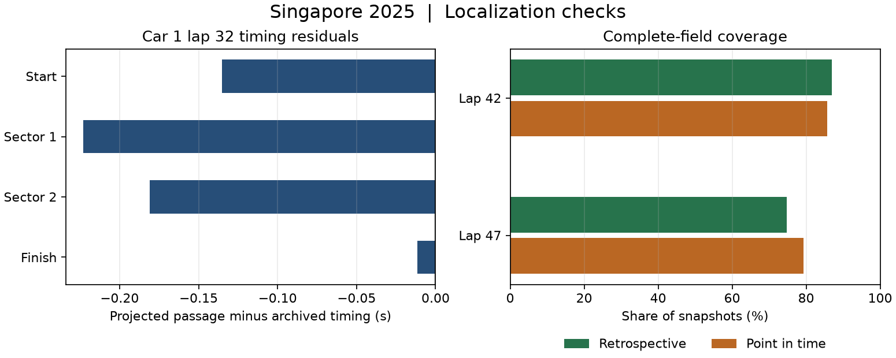
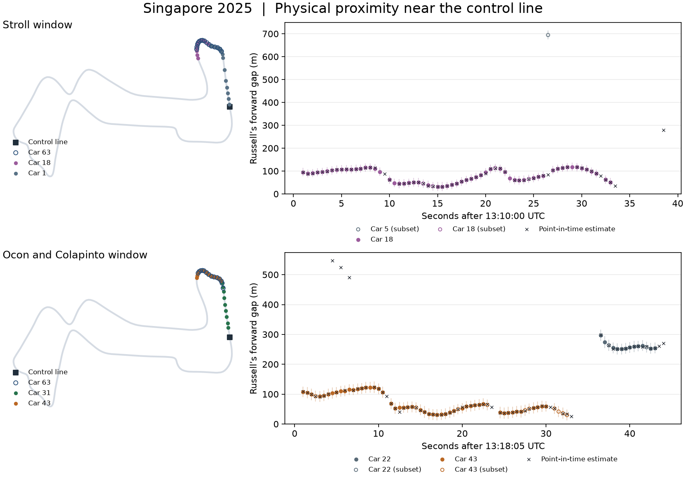
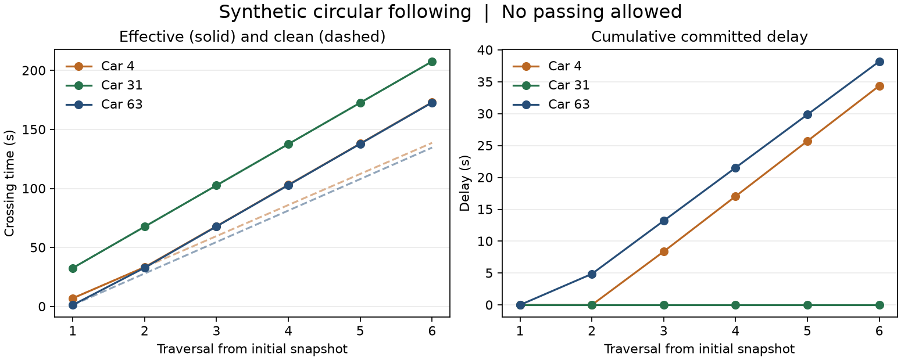

# Stage 5.3 — Physical track proximity and deterministic following

## Outcome

The engineering pilot reconstructed two 2025 Singapore windows, audited
Zandvoort and Baku timing, and verified synthetic following and S2 rejoin
behavior. The Singapore sample supports a first check of longitudinal order.
Empirical traffic-loss fitting and forecast calibration remain gated on
independent labels and chronological held-out races.

## Timing reconciliation

| Race | S0 positions matching official classification | Retrospective overlay | Local exclusion windows | Chequered timestamp residual |
| --- | ---: | ---: | ---: | ---: |
| Zandvoort | 6 / 18 | 18 / 18 | 15 | +1.387 s |
| Baku | 16 / 19 | 19 / 19 | 1 | +1.538 s |

At Zandvoort, the overlay applies Antonelli’s two elapsed penalties totaling
15 seconds and classifies Norris at P18. Norris completed 64 of 72 laps, the
minimum under the FIA’s 90% rule rounded down. The audit masks 14 lap-boundary
conflicts around laps 68–69 and one ambiguous Leclerc pit interval.
[Dutch GP classification](https://www.fia.com/system/files/decision-document/2025_dutch_grand_prix_-_final_race_classification.pdf) ·
[FIA sporting regulations, Article 62.2](https://api.fia.com/system/files/documents/fia_2025_formula_1_sporting_regulations_-_issue_5_-_2025-04-30.pdf)

At Baku, the overlay applies Albon’s 10-second penalty and masks an ambiguous
Ocon pit interval. Both races retain their recorded chequered-time
discrepancy for review. The adjustment is a retrospective audit layered on
S0, with a per-driver record of position changes and exclusion windows.
[Azerbaijan GP classification](https://www.fia.com/system/files/decision-document/2025_azerbaijan_grand_prix_-_final_race_classification.pdf) ·
[Timing audit and masks](stage5_s3_timing_reconciliation.json)

## Singapore physical reconstruction

Russell’s screened lap 31 supplied the sampled racing line. Its unclosed
endpoints were 8.47 m apart after scaling to the FIA layout length of
4,927 m. In the independent Verstappen lap-32 check, the four projected
passages at the control and sector lines were 0.012–0.223 s earlier than
archived timing. All 398 fixes in the validation window mapped to the loop.
Across 385 pairs, the median absolute error against archived car speed was
1.89 m/s. The data support longitudinal comparisons on this layout. Lateral
accuracy and uncertainty interval calibration remain unverified.
[FIA Singapore circuit map](https://www.fia.com/system/files/decision-document/2025_singapore_grand_prix_-_event_notes_-_circuit_map_pit_lane_emergency_exits_map_and_quarantine_zone.pdf) ·
[OpenF1 location data](https://openf1.org/docs/#location) ·
[Sampled geometry](stage5_s3_geometry.json)



| Russell lap start | Previous racing-route passage | Telemetry gap | Stage 1 physical gap | OpenF1 classification gap |
| --- | --- | ---: | ---: | ---: |
| 42 | Stroll | 1.475 s | 1.846 s | 0.0 |
| 47 | Colapinto | 1.484 s | 1.507 s | 0.0 |

Blue flags named Stroll in the first window and Ocon and Colapinto in the
second. Colapinto crossed the line ahead of Russell in the lap-47 comparison.
A blue flag identifies its recipient. Pairing it with an approaching car
requires separate physical evidence.

The pilot acquired 6,500 location rows from all 20 cars across 85 seconds.
The three-car subset and the full-field acquisition identified different
retrospective neighbors in 0 of 62 paired Stroll-window samples and 14 of 74
paired lap-47 samples. These pairs include estimates with incomplete
coverage. Requiring complete field localization and a resolved neighbor in
both modes gave 48 and 49 paired snapshots, respectively. All agreed on the
neighbor identity, with median absolute gap differences of 0.31 and 0.22 m
between point-in-time and retrospective estimates. Both modes share location
samples, so their agreement measures sensitivity to interpolation.



The maps show the three sampled cars from 11 through 18 seconds after each
window begins. In the gap plots, filled markers show a complete field and
hollow markers show a subset. The vertical bars show the retrospective
distance bounds. Crosses show point-in-time estimates. A gap at a common
timing line and a distance gap between simultaneous positions are measured
separately.

The exposure rule grouped 73 retrospective and 59 point-in-time candidates
across the field. It required green conditions, a resolved complete-field
neighbor and lap relationship, an upper gap bound of 120 m, and at least
two seconds of contiguous support. These counts describe the two pilot
windows. They provide no estimate of associated time loss.

## Deterministic following and rejoining

The synthetic field put the leading car 63 directly behind lapped car 31
across the control line, with car 4 behind car 63. All 18 traversals
conserved time to the microsecond. At each shared checkpoint the committed
crossings respected the declared 0.2 s headway. The clean-lap inputs were
80 s, 105 s and 79 s for cars 63, 31 and 4 respectively. Over the window
their committed delay was 38.20 s, 0 s and 34.38 s. Equal-pace inputs
produced zero added delay.



A separate S2 fixture verified a resolved synthetic rejoin at 211 s. Car 4
was 35.87 m behind car 63 in the declared equal-distance geometry. The
adapter declined precise localization for coarse net-loss visits. The
following engine runs a stable-order green window and commits its final
admissible crossing times directly. In-window route changes and online
rescheduling remain unverified.

## Reproduction and evidence limits

```bash
f1ri stage5-s3 --warehouse /path/to/singapore/f1ri.duckdb \
  --audit-warehouse /path/to/zandvoort-baku/f1ri.duckdb
python -m pytest -q
```

Use `--ingest` to fetch missing configured windows and install the
`modeling` extra for plotting. The run writes its configuration, raw-cache
hashes, geometry, timing masks, physical positions, neighborhoods, candidate
exposures, and traversal ledger under `artifacts/runs/stage5_s3_proximity`.
The test suite passed 148 tests, including the S0–S2 regression suite.
[Metrics](stage5_s3_metrics.json) · [Pilot specification](../../docs/STAGE5_S3_SPEC.md)

The archive uses observation timestamps as an availability proxy. Live feed
delays and a known pit entry before its report remain outside the evidence.
The cutoffs and gap bounds are pilot heuristics. A Traffic V1 comparison
requires independently supported episodes, a frozen out-of-sample clean-air
reference, and race-level held-out evaluation. Locked P1 remains a separate
artifact dependency.
