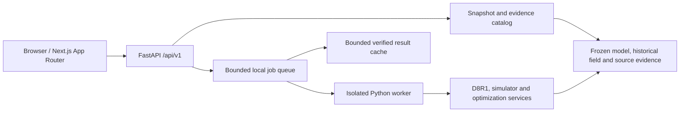

# S8-A web architecture

The browser owns the workspace selection and presentation. FastAPI owns the versioned contracts, catalog validation, legal policy enumeration and job state. A normalized context binds the preset, session, cutoff, driver, horizon, model hash and declared assumptions. A job binds that context to the operation, policy choices, objectives, futures and search budgets. The Python engine decides model, physics and recommendation support. Browser formatting converts integer microseconds to seconds for display and preserves unavailable values.

## Engine integration

- Forecast calls the S6-C D8R1 continuation and replacement adapter. It returns clean-air means and preserves each plan's supporting input and model hashes. The 2023–2025 model is mean-only, with G3 failed and 2026 transfer unsupported.
- Manual comparison uses the S6-C legal policy enumerator, common-markers scorer and cutoff-known/declared split. It includes stay-out as the reference. The request may add up to five alternatives.
- Conditional optimization calls the existing optimizer and reports its own completion and evaluated subset. Robust calls the existing family evaluator through the S6-C orchestration. The output distinguishes executable policies, adaptive triggers and retrospective oracle winners. Family weights are explicit when selected.
- Timing research recomputes the frozen S6-B.1 original comparator using its original S6-B evaluation library. It also returns the checked S6-B.1 policy and control ledgers, including the separate scheduled conditional policy.
- Historical fields come from the S6-C cutoff features and pinned S7-A event-time artifact. Classification remains a separate field. The S7-B and S7-C0 evidence views return bounded summaries and one approved checkpoint at a time.

## Stable API

Routes under `/api/v1` include `GET /presets`, `GET /presets/{id}`, `GET /presets/{id}/snapshot`, `POST /snapshots`, `GET /evidence` and shadow evidence summaries. Snapshot responses include driver options, legal policies, source classifications and data hashes. `POST /analyses` creates a job. Read or cancel it with `GET` or `DELETE /analyses/{id}`. A completed result can be exported from `GET /analyses/{id}/export`. `POST /replays` takes its original request and expected checksum and schedules verification against the engine. `GET /openapi.json` documents the versioned Pydantic envelopes. The UI validates the snapshot and job envelopes before rendering.

Identifiers and result checksums use sorted-key canonical JSON and SHA-256. The API binds exports to the venue, information mode and evaluation marker. Wall time, CPU and sampled RSS are execution observations outside result identity. Browser input edits invalidate incompatible results. Job state can move through queued/running to completed, failed, canceled or unsupported. A deterministic bounded search can finish with an incomplete result and recommendation withheld.

## Resources and trust

One worker process runs at a time, with up to four outstanding jobs. Each worker has a 35 s elapsed deadline and a sampled 720 MiB RSS ceiling. The API terminates workers on cancellation or an observed limit breach. It caps result documents, caches up to 32 retained jobs and enforces a 24 MB cache budget. Duplicate submissions share work. Verified identical exports are reproducible after process restart given matching pinned inputs. Slow HTTP handlers do not execute optimizer searches.

The application is private and local to a trusted OS user. Both entry points bind to loopback with a single API process. API host and CORS allowlists cover localhost. Cross-origin mutations and non-JSON posts are rejected. Requests are 16 KiB bounded, and no route accepts an arbitrary file path, model upload, archive upload, SQL or command. Large ledgers are projected to summary views before reaching the browser. There are no browser secrets or external font requests. The hero is an artwork asset with a generic race car. It is illustrative.
